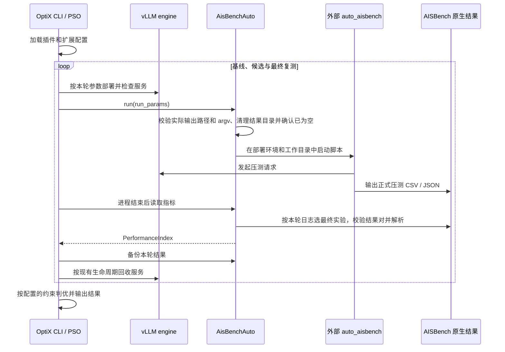

# OptiX 适配 auto_aisbench 详细设计

## 1. 背景与目标

auto_aisbench 可以组织数据生成、前缀预热及重复压测，但其外部脚本不能直接作为 OptiX 的 benchmark 使用。需要将 OptiX 的候选参数传递给脚本，并将 AISBench 原生结果转换为 OptiX 的性能指标。

本方案新增可独立安装的 `aisbench-auto-optix` 插件，复用 OptiX 插件加载、部署环境、进程管理和 PSO 搜索流程，以及内置 AISBench 的指标解析。用户通过以下命令运行完整寻优：

```bash
msmodeling optix -e vllm -b aisbench_auto -c /path/to/config.toml
```

交付范围是命令行寻优适配，不新增独立的 Web/API 服务。

## 2. 职责与边界

| 组件 | 职责 |
| --- | --- |
| OptiX CLI、优化器 | 加载配置、生成候选、调度服务部署及压测、计算适应度、输出寻优结果 |
| 现有 vLLM engine | 按当前候选部署、检查和停止 vLLM 服务 |
| 新增 `aisbench_auto` 插件 | 构建压测命令、注入候选参数、清理输出目录、选择最后一轮正式结果、读取及备份性能结果 |
| 外部 auto_aisbench 工具 | 管理模型与服务地址、鉴权、数据生成、前缀预热、重复执行及 AISBench 调用 |
| 内置 AISBench 解析器 | 读取 CSV/JSON，转换 TTFT、TPOT、吞吐量、成功率及最佳并发信息 |

## 3. 模块划分

新增代码集中在 `contrib/optix/aisbench_auto/`：

| 文件 | 内容 |
| --- | --- |
| `pyproject.toml` | 定义可选分发包及 `optix.plugins` entry point |
| `aisbench_auto/__init__.py` | 暴露公共注册入口 `register()` |
| `aisbench_auto/config.py` | 定义命令、benchmark 配置及扩展 Settings |
| `aisbench_auto/benchmark.py` | 实现 `AisBenchAuto(BenchmarkInterface)` |
| `aisbench_auto/results.py` | 按本轮日志选择最终实验，创建结果视图并复用 AISBench 指标解析器 |
| `tests/test_plugin.py` | 插件注册、配置、命令和结果读取等测试 |
| `README.md`、`config.example.toml` | 安装使用说明及需要合并到 engine 配置中的示例片段 |

用户指南增加插件入口说明；PSO 回归测试补充 TTFT 单约束判优场景。插件不实现新的搜索算法。

## 4. 注册和配置加载

entry point 定义为：

```toml
[project.entry-points."optix.plugins"]
aisbench_auto = "aisbench_auto:register"
```

OptiX 初始化时调用插件加载器，加载并执行 `register()`：

1. `register_benchmarks("aisbench_auto", AisBenchAuto)`，注册 benchmark 类。
2. `register_settings(lambda: AisBenchAutoSettings())`，登记扩展配置工厂。
3. 后续配置初始化使用 `AisBenchAutoSettings`，在原 `Settings` 上增加 `aisbench_auto` 配置节。

框架加载器对正常加载流程有进程内执行一次的保护，但 `register()` 本身有全局副作用。直接重复调用时，同名 benchmark 会告警并覆盖，settings 工厂也会被替换。它不会清空已经缓存的 settings 实例，因此必须在配置实例化之前完成注册。

当前 settings 扩展使用单个全局工厂，不保证与其他也替换该工厂的插件自动合并配置；多插件同时安装时需要注意加载顺序及配置兼容性。

## 5. 配置接口

### 5.1 配置字段

| 字段 | 类型与默认值 | 行为 |
| --- | --- | --- |
| `aisbench_auto.work_path` | Path，默认当前目录 | 外部脚本工作目录；运行时展开用户目录并解析为绝对路径 |
| `aisbench_auto.output_path` | Path，默认 `outputs/default` | 外部工具的原生结果目录；相对路径以工作目录为基准 |
| `aisbench_auto.process_name` | str，默认空串 | 供框架公共进程管理使用 |
| `aisbench_auto.command.executable` | str，默认 `python3` | 从部署环境 PATH 或指定路径查找解释器 |
| `aisbench_auto.command.script` | 非空 str，必填 | 外部脚本路径；相对路径以工作目录为基准，初始化时校验文件存在 |
| `aisbench_auto.command.others` | str，默认空串 | 其他脚本参数，通过 `shlex.split` 拆分 |
| `aisbench_auto.target_field` | `list[OptimizerConfigField]`，默认空列表 | 参数初始值及搜索范围，范围规范化复用 `range_to_enum` |
| `aisbench_auto.performance_config` | `PerformanceConfig` | 复用内置指标名和统计方式配置 |
| `aisbench_auto.best_concurrency_coefficient` | int，默认 3 | 复用 AISBench 最佳并发计算参数 |
| `aisbench_auto.best_concurrency_threshold` | int，默认 200 | 复用 AISBench 最佳并发计算参数 |

构造 benchmark 时支持显式配置模型、配置字典或从 settings 读取；显式空字典也进行校验，不回退到全局配置。配置经过深拷贝，运行期路径规范化不修改共享 settings。

### 5.2 配置片段

以下片段需要合并到已有的 vLLM/PSO 配置中，本身不构成完整寻优配置：

```toml
use_request_rate_calibration = false

[aisbench_auto]
work_path = "/opt/aisbench_auto_tools_prefix"
output_path = "outputs/default"

[aisbench_auto.command]
executable = "python3"
script = "aisbench_test.py"
others = "--dataset_type prefix_cache --prefix_test --repeat 1 --repeat_rate 50% --prefix_num 1 --seed 2 --input_len 2048 --output_len 512 --data_num 128"

[[aisbench_auto.target_field]]
name = "CONCURRENCY"
config_position = "env"
min = 8
max = 128
dtype = "int"
value = 32

[[aisbench_auto.target_field]]
name = "REQUESTRATE"
config_position = "env"
min = 0
max = 0
dtype = "float"
value = 0
```

`output_path` 必须与外部工具实际使用的输出目录一致。模型、服务地址和工具依赖仍在外部工具侧配置，插件不读取或改写其 `config.py`。

## 6. 命令构建与参数传递

### 6.1 对外方法

| 接口 | 输入 | 输出或副作用 |
| --- | --- | --- |
| `register()` | 无 | 写入 benchmark 注册表及 settings 工厂；返回 `None` |
| `AisBenchAuto(config, ..., runtime_ctx, deploy_env)` | 配置、部署上下文及环境 | 校验配置、解析路径并创建 benchmark 实例 |
| `update_command()` | 实例中的 command 配置 | 校验解释器和脚本，重建 argv 模板 |
| `before_run(run_params)` | 本轮 `OptimizerConfigField` 序列，可为空 | 替换并校验参数、清理结果目录、准备公共运行环境 |
| `run(run_params)` | 本轮候选 | 继承框架实现，异步启动外部子进程；不在此接口直接返回性能指标 |
| `get_performance_index()` | 本轮结果目录 | 返回 `PerformanceIndex`，异常时抛出错误 |
| `get_performance_metric()`、`get_best_concurrency()` | 指标/统计方式或结果目录 | 复用 AISBench 解析与计算 |
| `backup(del_log)`、`stop(del_log)` | 框架生命周期参数 | 复用结果备份和进程停止能力 |

### 6.2 argv 生成规则

模板为：

```text
[executable, script, *shlex.split(others),
 "--concurrency", "$CONCURRENCY", "--request_rate", "$REQUESTRATE"]
```

每轮先由 `target_field` 初始值建立参数表，再使用本轮候选覆盖同名值；参数名统一转为大写。对每个 argv 元素替换 `$NAME`，其中变量名匹配 `[A-Z][A-Z0-9_]*`。

例如，`others = '--dataset "/data/a b.jsonl" --seed $SEED'`，候选为 `CONCURRENCY=64`、`REQUESTRATE=0`、`SEED=2` 时，数据集路径保持为一个参数，请求率保留为 `0`。

实现每轮重新生成模板，避免上一轮值残留；先完成插件替换，再调用公共 `before_run()` 准备日志和环境，最后恢复构造好的 argv，保留参数边界及虚拟环境解释器的符号链接。子进程通过参数列表启动，不启用 shell。

`others` 不应再填写 `--concurrency` 或 `--request_rate`，以免与插件追加的参数重复。替换后统一扫描 argv 中残留的 `$NAME`；若存在，按名称排序、去重后抛出 `ValueError("Undefined benchmark parameters: ...")`。检查发生在结果目录清理、公共日志准备和外部脚本启动之前，错误信息只列变量名。使用者须提供初始值或本轮候选值，自动追加的 `CONCURRENCY`、`REQUESTRATE` 同样适用。每轮重新检查，不复用上一轮候选值。

## 7. 单轮评估与完整寻优流程



图中表示实际发生的评估，PSO 可能跳过重复候选，因此粒子数乘以迭代数不一定等于实际服务启动次数。部署调度及最终判优由既有 OptiX 流程负责，插件不额外维护一套生命周期。

## 8. 结果协议与指标映射

正式结果需满足内置 AISBench 目录约定：

```text
<output_path>/<run>/performances/<model>/<result>.csv
<output_path>/<run>/performances/<model>/<result>.json
```

插件的指标、性能汇总及最佳并发接口通过同一个结果读取器访问选中的 CSV/JSON，复用 `AisBench` 的指标解析和计算方法。读取器使用独立配置副本，不改变原始 `output_path` 或备份范围。JSON 路径由 CSV 替换后缀得到，选择阶段检查配套 JSON 存在且能解析。

| OptiX 字段 | 数据来源 | 单位或规则 |
| --- | --- | --- |
| `time_to_first_token` | CSV 中配置的 TTFT 指标及统计列 | 转换为秒；支持原解析器的 ms/us 单位 |
| `time_per_output_token` | CSV 中配置的 TPOT 指标及统计列 | 转换为秒 |
| `throughput` | JSON `Request Throughput` | 请求/秒 |
| `generate_speed` | JSON `Output Token Throughput` | 输出 token/秒，按现有解析器条件赋值 |
| `success_rate` | JSON `Success Requests / Total Requests` | 总请求非零时计算，保留现有零请求处理 |

JSON 汇总值优先读取 `total`，缺失时按内置解析器回退至 `stable`。缺少必需指标、统计列、JSON 或格式错误时沿用解析器异常，不构造虚假的成功指标。

### 8.1 插件内结果选择

用户直接配置原工具的 `aisbench_test.py`，不再依赖外部结果整理脚本。每轮执行前清理原始输出，并清空上轮读取器缓存；公共进程管理为本轮分配独立 stdout/stderr 日志。选择时要求子进程正常退出，不读取仍在运行或非零退出进程产生的中间结果。

从本轮日志按出现顺序提取 `Current exp folder: <path>`，解析 ANSI 颜色及相对路径后选择最后一项；路径必须是 `output_path` 的直接子目录。普通数据集至少应记录 `--repeat` 指定的实验次数；前缀数据集按原工具执行一次正式轮，`--prefix_test` 再增加一次预热，前缀分支的 `--repeat` 不生效。次数不足时直接报错，即使预热结果完整也不能代替正式轮。

最终实验必须恰好有一个性能 CSV 和同名可解析 JSON。最后目录缺失、不完整或越界，以及复用前一轮同一结果目录时均失败，不按时间戳、目录名排序或回退早期实验猜测。未启用多轮或独立预热且没有实验标记时，兼容原有唯一 CSV 结果协议；多组结果缺少本轮标记时拒绝读取。

选择成功后将结果对复制到 `output_path/.optix_selected/<experiment>/performances/<model>/`，生成 `selection.json` 记录策略 `last`、来源实验、CSV 路径及日志中的轮次数。该目录为插件保留目录，若外部工具已创建同名目录或符号链接则拒绝覆盖。读取器缓存仅在当前候选有效，允许框架关闭本轮日志后继续读取同一结果；下一候选重新清理和选择。

### 8.2 预热与重复压测口径

`--prefix_test` 取预热后的正式实验，普通数据集 `--repeat N` 取最后一次正式实验。插件不计算多轮平均值，避免混合不同轮次的 TTFT、吞吐量与并发数据。原始预热和正式轮目录全部保留，公共备份同时归档原始结果及选择视图，用户无需生成辅助脚本。

## 9. 输出清理、异常和运行约束

每轮运行前以工作目录为基准重新解析输出路径，展开用户目录并解析 `..` 和符号链接。目录保护在清理前执行：

- 输出目录不得等于工作目录或包含工作目录；工作目录下的专用结果子目录仍可使用。
- 输出目录不得与 `get_settings().output` 指向的 OptiX 寻优结果目录重叠，包括相同、包含该目录或位于该目录内。OptiX 结果目录也会解析为实际路径。
- 当前进程工作目录和用户家目录禁止作为输出目录；文件系统根目录由工作目录祖先保护覆盖。
- 输出路径已存在但不是目录时，抛出 `ValueError`，不会删除该文件。

构建 argv 并确认没有残留占位符后，调用公共 `remove_file()`。即使该函数只记录日志并返回，插件仍会检查输出目录：只有目录不存在或已为空，才准备公共运行环境并启动外部脚本；仍有内容时抛出 `ValueError("Benchmark output was not cleaned: ...")`，无法检查目录时沿用文件系统异常并中止。不允许在清理不完整后继续执行并读取旧结果。

这不是完整的文件系统隔离；其他不与受保护目录重叠的绝对路径仍可能通过校验，因此必须使用专用的可删除结果目录，不能指向其他重要目录。

| 情况 | 当前行为 |
| --- | --- |
| 缺少 benchmark 配置 | 构造时抛出 `ValueError` |
| 缺少 script、空 script 或无效配置 | Pydantic 校验失败 |
| 解释器不存在或脚本不是文件 | 抛出 `ValueError` |
| `others` 引号不匹配 | `shlex.split` 抛出异常 |
| 替换后仍有 `$NAME` 占位符 | 抛出 `ValueError`，列出缺失变量；不清理已有结果、不启动脚本 |
| 输出目录等于或包含工作目录 | 清理前抛出 `ValueError` |
| 输出目录与 OptiX 寻优结果目录重叠 | 清理前抛出 `ValueError` |
| 输出路径已存在且不是目录 | 抛出 `ValueError`，保留该文件 |
| 清理后目录仍非空 | 抛出 `ValueError`，不启动脚本 |
| 清理或目录检查抛出文件系统异常 | 中止本轮，不启动脚本 |
| 缺少最终结果、最终实验含多个 CSV、无标记的多组结果或轮次不足 | 抛出 `BenchmarkResultError`，不回退早期结果 |
| 子进程未完成、非零退出、最终目录越界或复用旧轮目录 | 抛出 `BenchmarkResultError` |
| 脚本非零退出 | 保留实际子进程退出状态，运行流程按框架处理；不会回退读取上一轮已清理的结果 |
| 配套 JSON 缺失或不可解析 | 选择阶段抛出 `BenchmarkResultError` |
| 必需指标缺失或指标格式错误 | 沿用 AISBench 解析器异常 |

同一工具工作目录和结果目录不支持多个寻优任务并发共享，否则会发生互相清理或覆盖；并发任务需分别配置目录及服务资源。插件也不承诺完整校验外部脚本参数、路径权限及工具内部配置。

## 10. 备选方案与取舍

| 方案 | 取舍 |
| --- | --- |
| 将外部工具实现合入主框架 | 需要同时维护数据、预热、压测等逻辑，扩大依赖与变更范围 |
| 修改内置 AISBench 以兼容外部脚本 | 会让已有 benchmark 承担两种不同启动及配置协议 |
| 独立插件调用外部脚本并复用解析器 | 保持部署可选、职责清晰，采用此方案；代价是依赖现有 AISBench 方法及结果布局 |

当前通过独立结果读取器复用 AISBench 方法减少重复实现，但存在对解析器接口、配置属性和结果结构的耦合。以后调整这些接口时，应同时运行插件回归。当前不扩大范围重构公共解析层。

## 11. 安装、兼容与回滚

插件要求 Python 3.10 及以上。用户须预先准备 msmodeling、vLLM、外部 auto_aisbench 和 AISBench 及各自依赖，再安装插件：

```bash
python -m pip install --no-deps -e contrib/optix/aisbench_auto
```

插件不声明自动安装这些工具的依赖。未安装插件时不会通过其 entry point 注册 `aisbench_auto`；使用其他 benchmark 的用户不需要增加该配置节。

回滚时停止本次寻优任务，卸载 `aisbench-auto-optix`，移除配置中的 `[aisbench_auto]` 及子配置，重新启动进程并选择已有 benchmark。已被运行前清理的输出目录不能通过卸载恢复，重要历史结果应事先保存在独立目录。

## 12. 验证与验收

### 12.1 单元测试

现有插件专项测试覆盖注册入口、真实子进程命令执行及指标读取、缺失结果、失败后不复用旧结果、引号参数、连续候选更新、请求率为零、输出目录保护、脚本必填及相对路径，以及配置模型/字典/settings 读取形式。新增回归覆盖每轮残留进程清理调用，以及未定义占位符、多个缺失变量去重排序、嵌入 JSON 的占位符、必需寻优参数缺失、初始值与候选覆盖顺序和下一轮不复用旧值；未定义占位符场景还验证不清理旧结果、不启动子进程。

```bash
python -m pytest -q -o addopts= \
  --confcutdir=contrib/optix/aisbench_auto/tests \
  contrib/optix/aisbench_auto/tests
```

目录保护回归覆盖工作目录及其祖先、OptiX 结果目录及其祖先/子目录、路径中的 `..` 和符号链接、清理函数静默返回、嵌套目录清理失败，以及输出路径误配为文件；拒绝或清理失败时验证旧数据保留、外部脚本未启动。

新增结果选择回归覆盖预热加正式轮、多轮最后结果、原始结果保留、同一结果用于指标和并发计算、失败不回退、轮次不足、无标记多组结果、目录越界、目录复用、缺失/损坏 JSON，以及连续候选不复用缓存。未运行的环境或异常场景不得记为通过。

### 12.2 已完成的实际环境验证

以下历史验证使用了外部结果整理包装脚本，验证的是当时的组合链路，不能作为本次插件内选择逻辑的服务器验证证据。本次实现的验证记录应单独列出。

2026-10-20 基于本文实现基线，已完成普通压测、前缀预热、三轮重复压测及参数搜索四个代表场景。每个场景使用随机种子 2、2 粒子、2 迭代，在 NPU 1 上运行完整的 OptiX + vLLM + auto_aisbench 流程。

- 累计实际部署 20 次 vLLM，3280 条正式请求及 5 条预热请求成功。
- 逐轮核对实际候选、服务参数，以及原生 CSV/JSON 与寻优输出的 TTFT、TPOT、吞吐量。
- 核对重复场景采用第三轮正式结果，预热场景不将预热结果计入正式评估；这些结果选择由外部包装脚本完成。
- 13 项插件测试与 185 项相关 OptiX 测试通过，共 198 项；不代表全仓测试通过。
- 测试服务及端口已回收。


### 12.3 插件内结果选择验证

2026-10-22，本次结果选择实现通过 56 项插件专项测试和 119 项相关 OptiX 回归，共 175 项。本地适用 pre-commit 检查通过。在服务器 `auto_aisbench` 容器的独立临时源码目录中，56 项插件测试再次通过；使用模拟外部子进程验证协议，不依赖辅助包装脚本。

本次未重新拉起 vLLM 或执行 NPU 寻优，不能将历史包装脚本的全链路测试结果视为新实现的实际环境验收结果。
