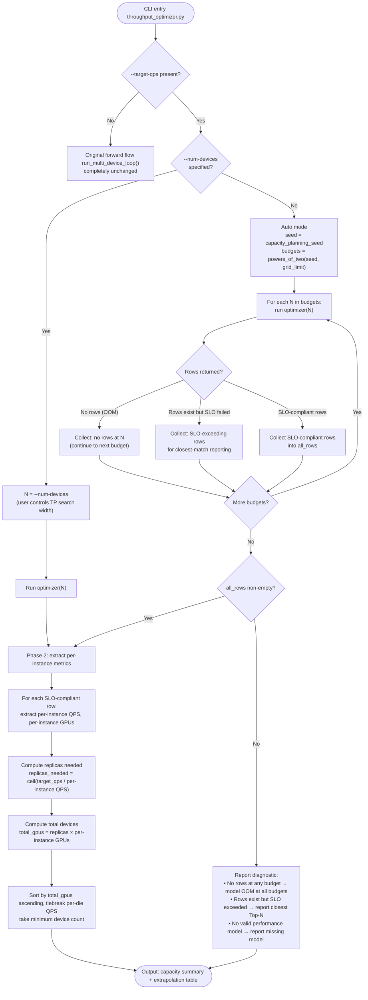
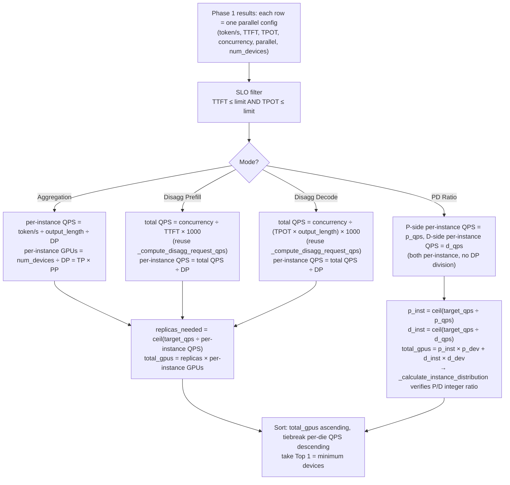

# RFC: Capacity Planning Mode

## Metadata

| Item | Content |
| :--- | :--- |
| **Status** | Draft |
| **Author** | @hudingyi |
| **Created** | 2026-09-20 |
| **Updated** | 2026-09-21 |
| **Related Links** | [Issue #227](https://gitcode.com/Ascend/msmodeling/issues/227) |

---

## 1. Overview

### 1.1 Summary

The current Throughput Optimizer solves the **forward problem**: given a device count (`--num-devices`) and fixed input/output lengths, it searches for the optimal parallel strategy and batch configuration, outputting QPS and instance distribution.

This proposal implements the **reverse problem** — a Capacity Planning mode: the user provides a **target QPS + SLO constraints + workload characteristics**, and the system automatically finds the minimum device count needed, along with the recommended parallel strategy, batch configuration, P/D instance ratio for disaggregated scenarios, and a device-count-vs-QPS comparison table.

### 1.2 Motivation

In real-world deployment scenarios, users need to answer: "I need 1000 QPS with TTFT ≤ 500ms and TPOT ≤ 50ms — how many cards do I need?" Currently, users must manually try different `--num-devices` values and repeatedly run the optimizer until the QPS meets the target. Pain points:

1. **Manual trial-and-error is inefficient**: users must repeatedly modify `--num-devices` and execute the full optimizer flow, with no automatic convergence to the minimum card count.
2. **Reverse search complexity**: searching the device-count dimension requires triggering the full optimizer flow at each step, with no automated search orchestration.

### 1.3 Goals

**Goals:**

- Add `--target-qps` parameter whose presence triggers capacity planning mode, outputting the minimum device count that meets the target
- Support both Aggregation and PD disaggregation (Disaggregation / PD Ratio) modes
- Output a device-count-vs-QPS comparison table
- Include unit tests with ≥ 80% coverage

**Non-Goals:**

- Do not modify the forward optimizer's core search logic (`BaseThroughputOptimizer` batch binary search unchanged)
- Do not introduce new performance models (reuse existing `analytic` / `profiling` models)
- Do not implement real-time traffic-driven online capacity planning (this is offline simulation)
- Do not implement multi-model co-location capacity planning (single model, single workload)
- Do not add prefix cache sensitivity scanning (existing `--prefix-cache-hit-rate` single value is sufficient; users can run multiple times to compare)
- Do not add percentile input parameters (existing `--input-length` YAML distribution already supports bins format)

---

## 2. Use Case Analysis

### 2.1 Aggregation Mode

**Scenario**: Deploy Qwen3-32B, target 1000 QPS, TTFT ≤ 500ms, TPOT ≤ 50ms, input 1024 / output 512.

```bash
python -m cli.inference.throughput_optimizer \
    Qwen/Qwen3-32B \
    --device=TEST_DEVICE \
    --input-length=1024 --output-length=512 \
    --ttft-limit=500 --tpot-limit=50 \
    --target-qps=1000
```

**Expected output**: minimum device count meeting 1000 QPS (e.g., 32 cards), recommended parallel config (e.g., TP=8, DP=4), and extrapolation comparison table.

### 2.2 PD Disaggregation Mode

**Scenario A**: User knows P uses 4 cards, D uses 2 cards, target 500 QPS.

```bash
python -m cli.inference.throughput_optimizer \
    Qwen/Qwen3-32B \
    --device=TEST_DEVICE \
    --input-length=2048 --output-length=512 \
    --ttft-limit=500 --tpot-limit=50 \
    --target-qps=500 \
    --enable-optimize-prefill-decode-ratio \
    --prefill-devices-per-instance=4 --decode-devices-per-instance=2
```

**Expected output**: minimum total device count meeting 500 QPS, P/D instance ratio such as `10P5D (P4 D2)`.

**Scenario B**: User doesn't know P/D card counts, only provides target QPS.

```bash
python -m cli.inference.throughput_optimizer \
    Qwen/Qwen3-32B \
    --device=TEST_DEVICE \
    --input-length=2048 --output-length=512 \
    --ttft-limit=500 --tpot-limit=50 \
    --target-qps=500 \
    --enable-optimize-prefill-decode-ratio
    # No --prefill/decode-devices-per-instance
```

**Expected output**: Phase 0 auto-enumerates (p_dev, d_dev) combinations (e.g., P4D2, P8D4, P2D2), finds the topology with minimum total devices.

### 2.3 Length Distribution Input

**Scenario**: User uses existing `--input-length` YAML file for length distribution.

```bash
python -m cli.inference.throughput_optimizer \
    Qwen/Qwen3-32B \
    --device=TEST_DEVICE \
    --input-length=length_distribution.yaml --output-length=512 \
    --ttft-limit=500 --tpot-limit=50 \
    --target-qps=1000
```

**Note**: Reuses existing `load_length_distribution` path, no new parameter needed.

### 2.4 Specified Search Range

**Scenario**: User knows the approximate range, specifies `--num-devices` to control TP search width.

```bash
python -m cli.inference.throughput_optimizer \
    Qwen/Qwen3-32B \
    --device=TEST_DEVICE \
    --input-length=1024 --output-length=512 \
    --ttft-limit=500 --tpot-limit=50 \
    --target-qps=1000 --num-devices=16
```

**Note**: optimizer searches TP∈{1,2,4,8,16} in one run, extrapolation table shows all feasible configs with per-die QPS.

### 2.5 Auto Mode (Unknown Device Count)

**Scenario**: User doesn't know how many cards needed (e.g., large model Kimi-K3), only provides target and constraints.

```bash
python -m cli.inference.throughput_optimizer \
    Kimi-K3 \
    --device=ATLAS_800_A3_752T_128G_DIE \
    --input-length=8192 --output-length=1024 \
    --ttft-limit=500 --tpot-limit=50 \
    --target-qps=1000
    # No --num-devices
```

**Note**: Auto-detects starting point from `DeviceProfile.capacity_planning_seed` (A3 inner dim 8), enumerates all power-of-2 budgets (8→16→32→64→...) up to grid limit, collects SLO-compliant rows from all budgets. Extrapolation table shows all feasible configs with per-die QPS.

---

## 3. Detailed Design

### 3.1 Overall Design

Capacity planning uses a **Linear Extrapolation** strategy: run the existing forward optimizer once at a reference device count to search optimal parallel configs, then linearly extrapolate **per-instance QPS** to directly compute the instance count and total devices needed to meet the target QPS.

**Core assumption**: DP instances are independent (no inter-instance communication), so per-instance QPS = total QPS / DP, and throughput scales **linearly** with instance count. `replicas_needed = ceil(target_qps / per_replica_qps)`, `total_gpus = replicas_needed * per_replica_gpus`. Configs where EP communication groups span across DP replica boundaries are not independently replicable and are skipped with a warning. The independence check uses `ParallelGroupManager` to compute the actual EP rank group for each candidate and verifies it is a subset of a single DP replica's rank set (not just `ep_size > per_replica_gpus`, which only compares sizes and can pass configs whose EP groups cross replica boundaries).

**CLI trigger rule**: `--target-qps` presence implicitly triggers capacity planning mode. `--num-devices` is optional: when specified, it controls TP search width; when omitted, the starting point is auto-detected from `DeviceProfile.comm_grid` with escalation as needed.

**Module relationship**:

```bash
┌──────────────────────────────────────────────────────────┐
│           throughput_optimizer.py (CLI)                   │
│  New: --target-qps (only new parameter)                  │
│  Reuse: --num-devices (optional, TP search width)        │
│         --ttft-limit / --tpot-limit (SLO)                │
│         --input-length (int/YAML) / --output-length      │
│         --prefix-cache-hit-rate (single value)           │
│         --disagg / --enable-optimize-prefill-decode-ratio│
│         --prefill/decode-devices-per-instance            │
│         --tp-sizes / --ep-sizes / ... (search dims)      │
└───────────────────┬──────────────────────────────────────┘
                    │
                    ▼
┌─────────────────────────────────────────────────────────┐
│            CapacityPlanner (new)                         │
│  Phase 0: determine search range (user/auto-escalate)   │
│  Phase 1: run existing optimizer → all parallel configs │
│  Phase 2: extract per-instance QPS → extrapolate → rank │
└───────────────────┬─────────────────────────────────────┘
                    │
                    ▼
          Existing ParallelRunner + BaseThroughputOptimizer
     (batch binary search + parallel candidate search, unchanged)
```

**Capacity planning main flow**:



**Flow description**:

- **User specifies `--num-devices`**: run optimizer once at that device count, searching TP∈{1,2,4,...,N}. Suitable when user knows the approximate range. Single run, simplest.
- **`--num-devices` omitted (auto mode)**: derive starting point from `DeviceProfile.capacity_planning_seed`. This attribute is dimension-agnostic: for multi-dim grids (e.g., A3 `[48,8,2]`), it returns the second-innermost dimension (single-node, e.g., 8); for 1-D grids (e.g., `(8,)` or `(16,)`), it returns the single dimension. If `capacity_planning_seed` is not defined on the profile, fall back to `min(comm_grid.grid.shape)` (smallest topology dimension ≥ 2). Enumerate all power-of-2 budgets from seed to `comm_grid.nelement()`. Upper limit is `comm_grid.nelement()`.
- **Phase 1 (existing optimizer)**: run existing optimizer at the determined N, obtain all parallel config result rows.
- **Phase 2 (linear extrapolation)**: for each SLO-compliant row, extract per-instance QPS and per-instance device count, compute required instances and total devices, rank by minimum.
- Auto mode logic is internal to `CapacityPlanner`, no changes to existing `ParallelRunner`. When `--target-qps` is absent, the original flow runs unchanged.

### 3.2 CLI Entry Extension

#### 3.2.1 New Parameter

| Parameter | Type | Default | Description |
| :--- | :--- | :--- | :--- |
| `--target-qps` | float | None | Target QPS (req/s). Presence triggers capacity planning mode. |

**Registration**: `cli/registry/modules/throughput_optimizer.py`, new `TARGET_QPS` Param in "Service Options" group.

#### 3.2.2 Reused Existing Parameters

| Existing Parameter | Role in Capacity Planning | Notes |
| :--- | :--- | :--- |
| `--num-devices` | TP search width (optional) | Specified: run optimizer once; omitted: auto-detect from comm_grid. Parser-level validator nulls `num_devices` when `--target-qps` present and `--num-devices` not explicitly provided |
| `--ttft-limit` / `--tpot-limit` | SLO constraints | Compliance check condition |
| `--input-length` | Workload | Integer or YAML distribution, reused as-is |
| `--output-length` | Workload | Single value, reused as-is |
| `--prefix-cache-hit-rate` | Workload | Single value, reused as-is |
| `--disagg` | Mode selection | Reused as-is |
| `--enable-optimize-prefill-decode-ratio` | Mode selection | Reused as-is |
| `--prefill/decode-devices-per-instance` | PD per-instance cards | Optional in capacity planning: specified = fixed combo; omitted = auto-enumerate |
| `--tp-sizes` / `--ep-sizes` / ... | Parallel search dims | Reused as-is |
| `--device` | Hardware target | Reused as-is |

**Zero modifications to existing parameters**: all `data_type`, `default`, `nargs` definitions unchanged.

#### 3.2.3 Validation Rules

Validation is split between the **parsing layer** and `CapacityPlanner`. The parsing layer must preserve whether `--num-devices` was explicitly provided (via `num_devices_was_provided` flag set in `arg_parse()`), **before** any candidate upper-bound validation. When `--target-qps` is present and `--num-devices` was not explicitly provided, candidate upper-bound validation is **deferred** — `num_devices` is set to `None` so that `CapacityPlanner` can auto-detect the starting budget. This avoids the problem where the default `num_devices=1` causes `_normalize_and_validate()` to reject valid TP/EP candidates before capacity planning starts.

| Rule | Layer | Description |
| :--- | :--- | :--- |
| `--target-qps` must be positive | Parser | Param declares `exclusive_min=0` |
| `--target-qps` present + `--num-devices` omitted → `num_devices = None` | Parser | `arg_parse()` sets `num_devices_was_provided` flag; validator nulls `num_devices` when target-qps present and flag is false; candidate upper-bound validation skipped |
| `--target-qps` present + `--num-devices` specified → user controls TP search width | Parser | `num_devices` keeps user value; candidate validation runs normally |
| `--target-qps` absent → `--num-devices` keeps original semantics | Parser | Forward mode unaffected, default=1, original validation |

### 3.3 Linear Extrapolation Strategy

#### 3.3.1 Phase 0: Determine Search Range

**Method A: User specifies `--num-devices`** (known budget or approximate range)

```text
N = args.num_devices
Run optimizer(N) → search TP∈{1,2,4,...,N}
```

**Method B: `--num-devices` omitted** (real deployment, unknown device count)

Auto-detect starting budget from `DeviceProfile.capacity_planning_seed` (dimension-agnostic: for multi-dim grids like A3 `[48,8,2]` → second-innermost dim 8; for 1-D grids like `(16,)` → the single dimension; fallback: `min(comm_grid.grid.shape)`). Enumerate **all** power-of-2 budgets from seed to `comm_grid.nelement()`, run optimizer at each budget, collect all SLO-compliant rows across all budgets for Phase 2:

```text
seed = DeviceProfile.capacity_planning_seed  # e.g., 8
limit = comm_grid.nelement()                 # e.g., 768
budgets = powers_of_two_from(seed, limit)    # [8, 16, 32, 64, ..., limit]
all_rows = []
for N in budgets:
    run optimizer(N)
    collect SLO-compliant rows → all_rows
# Phase 2 ranks all_rows by total_gpus ascending
```

Kimi-K3 on A3 actual path:
```text
budgets = [8, 16, 32, 64, 128, 256, 512, 768]
N=8   → OOM (no rows) → continue
N=16  → OOM → continue
N=32  → fits, collect SLO-compliant rows
N=64  → fits, collect SLO-compliant rows (includes TP=64)
...   → remaining budgets also searched
all_rows merged → Phase 2 ranks by total_gpus
```

**Full enumeration rationale**: stopping after `first_fit × 2` cannot guarantee global minimum because per-die QPS is non-monotonic — a larger budget may yield a TP with significantly better per-die efficiency, producing fewer total GPUs despite using more per-instance. Enumerating all power-of-2 budgets up to the grid limit is bounded (e.g., A3: 768 → 8 budgets) and guarantees the global minimum within the searched candidate domain.

#### 3.3.2 Phase 2: Linear Extrapolation

Core formula:

```python
per_instance_qps = total_qps / DP                    # per-instance QPS
per_instance_gpus = num_devices / DP = TP × PP       # per-instance device count
replicas_needed = ceil(target_qps / per_instance_qps) # required instances
total_gpus = replicas_needed × per_instance_gpus      # total devices
```

**Why linear scaling holds**: DP instances have no communication (each processes different requests independently), so total QPS = per-instance QPS × instance count.

**Cache reuse**: `_forward_record_cache` and `ForwardLatencyTable` are automatically reused within each optimizer call. Normally Phase 1 runs once, results feed directly into Phase 2.

### 3.4 Per-Instance Metric Extraction

**Extraction and extrapolation flow**:



#### 3.4.1 Aggregation Mode

Phase 1 calls `ParallelRunner.run_agg()`. Per-instance QPS:

```text
per-phase request QPS = token/s / output_length
per_instance_req_qps = per-phase request QPS / DP
per_instance_gpus = num_devices / DP = TP × PP
```

Extrapolation:
```python
replicas_needed = ceil(target_qps / per_instance_req_qps)
total_gpus = replicas_needed × per_instance_gpus
```

**Reuse**: `get_summary_df()` rows have `token/s` column; divide by `output_length` and `dp_size`.

#### 3.4.2 Disagg Prefill Mode

`--disagg` with only `--ttft-limit`:
```text
per-phase request QPS = concurrency / ttft * 1000
per_instance_req_qps = per-phase request QPS / DP
```

**Reuse**: `_compute_disagg_request_qps()` already implements this.

#### 3.4.3 Disagg Decode Mode

`--disagg` with only `--tpot-limit`:
```text
per-phase request QPS = concurrency / (tpot * output_length) * 1000
per_instance_req_qps = per-phase request QPS / DP
```

**Reuse**: same as above.

#### 3.4.4 PD Ratio Mode

Supports two input methods:

**Method A: User specifies per-instance cards**
```bash
--target-qps=500 --enable-optimize-prefill-decode-ratio \
--prefill-devices-per-instance=4 --decode-devices-per-instance=2
```

**Method B: Auto-search** (new in capacity planning)
```bash
--target-qps=500 --enable-optimize-prefill-decode-ratio
# No per-instance specification
```

Phase 0 auto-search generates the complete set of `ParallelSearchCandidate` from `--tp-sizes` (and default TP/PP search dims), extracts and deduplicates the actual per-instance device budget (`per_instance_gpus = TP × PP`) for each candidate, then enumerates (p_budget, d_budget) pairs. This ensures PP>1 configurations are not missed — the per-instance budget is `TP × PP`, not just `TP`. The search space is controlled by `--tp-sizes` / `--pp-sizes`:

```text
# 1. Generate full parallel candidates for P and D phases
p_candidates = ParallelSearchCandidate.from_search_dims(tp_sizes, pp_sizes, ...)
d_candidates = ParallelSearchCandidate.from_search_dims(tp_sizes, pp_sizes, ...)

# 2. Extract and deduplicate per-instance device budgets (TP × PP)
p_budgets = sorted(set(c.per_instance_gpus for c in p_candidates))  # e.g., {2, 4, 8, 16}
d_budgets = sorted(set(c.per_instance_gpus for c in d_candidates))

# 3. For each (p_budget, d_budget) pair, run PD ratio optimizer
for p_budget in p_budgets:
    for d_budget in d_budgets:
        run_args = copy(args)
        run_args.prefill_devices_per_instance = p_budget
        run_args.decode_devices_per_instance = d_budget
        run_args.num_devices = p_budget + d_budget
        run _run_pd_ratio(run_args) → collect (p_config, d_config, p_qps, d_qps) rows
merge all results → Phase 2
```

**Note**: `_run_pd_ratio` is called via `ParallelRunner` with `run_args.prefill_devices_per_instance` and `run_args.decode_devices_per_instance` set — these are the **per-instance total device budgets** (`TP × PP`), not raw TP values. This is consistent with how the forward PD ratio mode works: the optimizer internally searches TP/PP/EP within the given per-instance budget.

**Extrapolation formula** (P/D independent, not "per-pair"):

P-side and D-side per-instance QPS are consumed **directly** from `PDRatioThroughputOptimizer.optimize()`, which already computes them using the correct producer semantics. The planner must **not** re-derive QPS from raw metrics to avoid formula drift:

- **P-side**: `p_qps = p_concurrency / prefill_phase_makespan_ms × 1000` (uses `prefill_phase_makespan_ms`, not TTFT — the existing producer accounts for full prefill span)
- **D-side**: `d_qps = d_concurrency / (d_tpot × max(output_length - 1, 1)) × 1000` (uses `max(output_length - 1, 1)`, not full `output_length` — the existing producer excludes the first token which is covered by prefill)

```python
# Consume directly from PDRatioThroughputOptimizer — do NOT re-derive
p_qps = optimizer_result.p_qps    # per P instance, already correct
d_qps = optimizer_result.d_qps    # per D instance, already correct
```

```python
p_inst = ceil(target_qps / p_qps)     # P instances needed
d_inst = ceil(target_qps / d_qps)     # D instances needed
total_gpus = p_inst × p_dev + d_inst × d_dev
system_qps = min(p_inst × p_qps, d_inst × d_qps)   # verify ≥ target_qps
```

When balanced: `p_inst / d_inst ≈ d_qps / p_qps = pd_ratio`, both sides meet target simultaneously.

**Instance distribution verification**: `_calculate_instance_distribution()` adjusts integer ratio under `total_gpus`.

**Topology naming**: results expressed as **xPyD (Pn Dm)**, e.g., `10P5D (P4 D2)` = 10 P instances (4 cards each) + 5 D instances (2 cards each) = 50 cards.

#### 3.4.5 Reuse Summary

| Calculation | Existing Code | Reusable |
| :--- | :--- | :--- |
| All parallel config rows (SLO filter + ranking) | `OptimizerSummary.get_summary_df()` | ✅ |
| Disagg Prefill total QPS | `_compute_disagg_request_qps()` | ✅ |
| Disagg Decode total QPS | `_compute_disagg_request_qps()` | ✅ |
| PD Ratio per-instance QPS | `PDRatioThroughputOptimizer.optimize()` | ✅ |
| PD Ratio instance distribution | `_calculate_instance_distribution()` | ✅ |
| **Aggregation per-instance QPS** | None (`token/s ÷ output_length ÷ DP`) | ❌ Add |
| **PD independent extrapolation** | None (`ceil(target/p_qps)×p_dev + ceil(target/d_qps)×d_dev`) | ❌ Add |
| **PD auto-search** | None (enumerate p_dev×d_dev) | ❌ Add |
| **Disagg per-instance QPS** | None (`qps_req_s ÷ DP`) | ❌ Add |

### 3.5 Output

#### 3.5.1 Capacity Planning Summary

```text
************************************************************************************
  Capacity Planning Result
  --------------------------------------------------------------------------------
  Target QPS:  1000.00 req/s
  SLO:         TTFT <= 500 ms, TPOT <= 50 ms
  --------------------------------------------------------------------------------
  Minimum Devices: 32
  Achieved QPS:     1058.33 req/s
  Per-Die QPS:       33.07 req/s
  Replicas Needed:  4
  Per-Replica QPS:  264.58 req/s
  Per-Replica Dies: 8
  Recommended Parallel: TP=16 | PP=1 | DP=1 (per replica)
  Batch Size:        64
  TTFT:              312.45 ms
  TPOT:              38.20 ms
  --------------------------------------------------------------------------------
  [PD Ratio Mode]                                    ← PD mode only
  Topology: 10P5D (P4 D2)
  P Instances: 10 (40 devices)
  D Instances: 5 (10 devices)
  PD Ratio:    2.00
************************************************************************************
```

#### 3.5.2 Extrapolation Comparison Table

Sorted by **total devices ascending**, tiebreak **per-die QPS highest**:

```text
************************************************************************************
  Extrapolation Comparison (sorted by total_gpus, tiebreak per-die QPS)
  --------------------------------------------------------------------------------
  | Parallel        | Per-Inst QPS | Per-Inst GPUs | Replicas | Total | Per-Die QPS |
  |-----------------|-------------|--------------|---------|-------|---------|
  | TP=16\| PP=1     |    600.00   |         16   |       2 |    32 |   37.50 |  ← recommended: min cards, highest per-die
  | TP=8 \| PP=1     |    264.58   |          8   |       4 |    32 |   33.07 |
  | TP=4 \| PP=1     |     85.42   |          4   |      12 |    48 |   21.36 |
  | TP=2 \| PP=1     |     42.30   |          2   |      24 |    48 |   21.15 |
  | TP=8 \| PP=2     |    180.00   |         16   |       6 |    96 |   11.25 |
************************************************************************************
```

**Per-Die QPS** = per-instance QPS ÷ per-instance GPUs, measures per-die utilization efficiency.

**Ranking rules**:
1. Primary: total devices ascending → find minimum that meets target
2. Tiebreak: per-die QPS descending → highest efficiency at same device count

**Efficiency tradeoff**: the minimum device count config (e.g., TP=16, 32 cards) is also the highest per-die QPS in this example. In general, the recommended config is the one with the fewest total GPUs; ties are broken by highest per-die QPS. Users can compare in the table and increase `--num-devices` or use `--tp-sizes` to explore larger TP ranges.

### 3.6 DFX Design

**Compatibility**: `--target-qps` is optional (default None), forward optimizer flow unchanged when absent.

**Maintainability**: capacity planning logic isolated in `capacity_planner.py`, no intrusion into `BaseThroughputOptimizer` / `ParallelRunner`.

**Testability**: Phase 0 escalation, Phase 2 extrapolation, and per-instance QPS extraction can all be independently unit-tested with mocked DataFrames.

**Reliability**: Phase 0 enumerates all power-of-2 budgets up to `comm_grid.nelement()` (bounded, e.g., A3: 8 budgets); reports distinct diagnostics on failure — (1) no rows at any budget (model OOM), (2) rows exist but SLO exceeded (report closest Top-N), (3) missing performance model — rather than silently returning a single "cannot fit" error.

### 3.7 Programming Interface

#### 3.7.1 Programming Model

```python
from serving_cast.service.capacity_planner import CapacityPlanner, CapacityPlanConfig

config = CapacityPlanConfig(
    target_qps=1000.0,
    ttft_limit=500.0,
    tpot_limit=50.0,
    mode="aggregation",  # or "pd_ratio", "disagg_prefill", "disagg_decode"
)
planner = CapacityPlanner(config)
result = planner.run(args)
```

#### 3.7.2 API Definitions

**CapacityPlanConfig**:

| Parameter | Type | Description | Range |
| :--- | :--- | :--- | :--- |
| target_qps | float | Target QPS (req/s) | > 0 |
| ttft_limit | float \| None | TTFT SLO limit (ms) | > 0 or None |
| tpot_limit | float \| None | TPOT SLO limit (ms) | > 0 or None |
| mode | str | Optimization mode | "aggregation" / "pd_ratio" / "disagg_prefill" / "disagg_decode" |

**CapacityPlanResult**:

| Field | Type | Description |
| :--- | :--- | :--- |
| minimum_devices | int \| None | Minimum total devices (None = not feasible) |
| achieved_qps | float | Achieved QPS at minimum devices |
| per_gpu_qps | float | Per-die QPS (= achieved_qps / minimum_devices) |
| replicas_needed | int \| None | Required instances (agg/disagg) or P/D counts (PD ratio) |
| best_config | dict | Recommended config (parallel, batch_size, concurrency, ttft, tpot) |
| scaling_table | list[dict] | Extrapolation comparison table |
| pd_ratio_info | dict \| None | PD mode P/D instance ratio info (e.g., `10P5D (P4 D2)`) |

#### 3.7.3 Usage Notes

1. `--target-qps` presence triggers capacity planning mode (no separate flag)
2. `--num-devices` optional: specified = TP search width; omitted = auto from comm_grid
3. `--target-qps` absent → `--num-devices` keeps original forward semantics
4. PD Ratio mode: specify per-instance = fixed combo; omit = auto-enumerate via `--tp-sizes` / `--pp-sizes`. Auto-search generates complete `ParallelSearchCandidate` set, extracts per-instance budgets (`TP × PP`), and enumerates all (p_budget, d_budget) pairs

---

## 4. Test Design

### 4.1 Unit Tests

| Test File | Scenario | Description |
| :--- | :--- | :--- |
| `tests/regression/serving_cast/test_service/test_capacity_planner.py` | Phase 0-user-specified | `--num-devices=16` → single run, no escalation |
| | Phase 0-auto-no-escalation | Mock returns valid results, no escalation triggered |
| | Phase 0-auto-full-enumeration | Mock returns valid at some budgets and empty at others, verify all budgets searched and rows merged |
| | Phase 0-auto-all-oom | Mock always returns empty, verify reports diagnostic at comm_grid limit |
| | Phase 0-auto-slo-exceeded | Mock returns rows but none SLO-compliant, verify reports closest Top-N |
| | Phase 0-auto-derive | When `--num-devices` unspecified, auto-derive from `DeviceProfile.capacity_planning_seed` |
| | Extrapolate-aggregation | Verify `per_instance_qps = token/s / output_length / dp_size` |
| | Extrapolate-disagg-prefill | Verify `qps_req_s / dp_size` extraction |
| | Extrapolate-disagg-decode | Same, decode formula |
| | Extrapolate-PD-ratio | Verify P/D independent scaling |
| | PD-auto-search | Verify enumeration of (p_dev, d_dev) combinations |
| | PD-topology-naming | Verify `xPyD (Pn Dm)` format |
| | Ranking | Sort by total_gpus ascending, tiebreak per-die QPS |
| | No-SLO-compliant | Returns None + closest Top-N |
| | Forward-mode-unaffected | Without `--target-qps`, original flow unchanged |

### 4.2 Integration Tests

| Scenario | Description |
| :--- | :--- |
| Aggregation E2E | Real model + device profile, verify minimum devices |
| PD Ratio E2E | Real model + PD config, verify P/D instance ratio |
| E2E consistency | Optimizer results consistent with/without `--target-qps` (`tests/e2e/test_capacity_planning_e2e.py`) |
| Forward unaffected | Without `--target-qps`, original flow unchanged |

### 4.3 Coverage Target

`capacity_planner.py` unit test coverage ≥ 80%, covering Phase 0 (user/auto/no-escalation/OOM/explore/limit), extrapolation (aggregation/disagg/PD ratio), ranking, and boundary values.

---

## 5. Drawbacks and Risks

| Risk | Description | Mitigation |
| :--- | :--- | :--- |
| Auto-mode multiple runs | Large models may need escalation (8→16→32→64), each running optimizer | 1. Log progress per step; 2. User can specify `--num-devices=64` for single run; 3. Budget count is bounded (log₂ of grid limit, e.g., A3: ≤10 runs) |
| PD auto-search combinatorial explosion | Enumerating (p_dev, d_dev) combinations, each running PD ratio optimizer | 1. Search space controlled by `--tp-sizes` (default powers of 2); 2. User can specify per-instance for fixed combo |

---

## 6. Open Questions

1. **Multi-device-profile capacity planning**: `--device` supports multiple values (cross-hardware). Should capacity planning search each profile independently? Suggest yes, output comparison table.
2. **Search result cache persistence**: Should intermediate results be persisted for checkpoint/resume? Suggest defer to future.
3. **Output length distribution**: `--output-length` is single value. Support distribution? Issue mentions "at least P50/P90/P99" mainly for input length; output length suggests defer.

---

## Appendix

### File Changes

| File | Description |
| :--- | :--- |
| `serving_cast/service/capacity_planner.py` | **New**: CapacityPlanner core class + result rendering |
| `cli/registry/modules/throughput_optimizer.py` | **Modified**: `TARGET_QPS` Param |
| `cli/registry/validators.py` | **Modified**: `target_qps_num_devices_semantics` validator: when `--target-qps` is present and `--num-devices` was not explicitly provided, sets `num_devices = None` to enable auto-detect (replaces earlier `sys.argv` detection approach which could not intercept parser-stage validation) |
| `cli/inference/throughput_optimizer.py` | **Modified**: `run_capacity_planning()` function, `main()` dispatch |
| `tests/regression/serving_cast/test_service/test_capacity_planner.py` | **New**: Unit tests |
| `tests/e2e/test_capacity_planning_e2e.py` | **New**: E2E consistency tests |

### References

- [Issue #227: Capacity Planning](https://gitcode.com/Ascend/msmodeling/issues/227)
- msmodeling `BaseThroughputOptimizer.run()` (`serving_cast/service/base_throughput_optimizer.py`)
- msmodeling `OptimizerData.length_distribution` (`serving_cast/service/utils.py`)
- msmodeling `PDRatioThroughputOptimizer` (`serving_cast/service/pd_ratio_throughput_optimizer.py`)
- msmodeling `OptimizerSummary._calculate_instance_distribution` (`serving_cast/service/optimizer_summary.py`)

### Glossary

| Term | Meaning |
| :--- | :--- |
| Capacity Planning | Given target QPS + SLO, find required hardware resources |
| QPS | Queries Per Second |
| SLO | Service Level Objective (TTFT / TPOT) |
| TTFT | Time To First Token |
| TPOT | Time Per Output Token |
| PD Ratio | Prefill / Decode instance ratio |
| Per-Die QPS | QPS per individual die, measures utilization efficiency |
