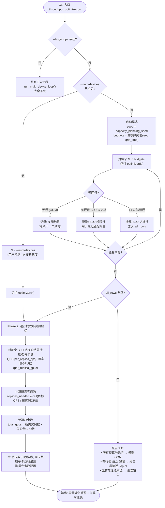
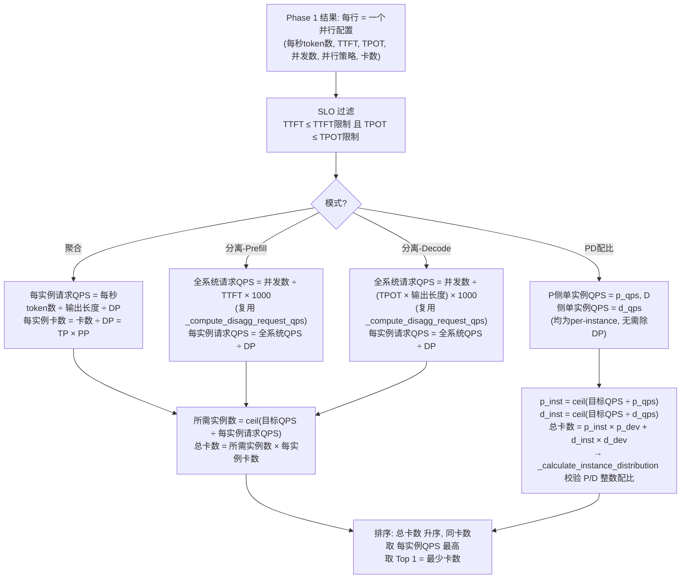

# RFC: 容量规划模式

## 元数据

| 项目 | 内容 |
| :--- | :--- |
| **状态** | Draft |
| **作者** | @hudingyi |
| **创建日期** | 2026-09-20 |
| **更新日期** | 2026-09-21 |
| **相关链接** | [Issue #227](https://gitcode.com/Ascend/msmodeling/issues/227) |

---

## 1. 概述

### 1.1 简介

当前 Throughput Optimizer 解决的是**正向问题**：给定硬件卡数（`--num-devices`）、固定的 input/output length，搜索最优并行策略和 batch 配置，输出 QPS 与实例分布。

本提案实现**反向问题**的容量规划（Capacity Planning）模式：用户输入**目标 QPS + SLO 约束 + 负载特征**，系统自动在卡数维度上搜索，输出满足目标所需的最少卡数 / 实例数、推荐并行策略与 batch 配置、PD 分离场景下的 P/D 实例配比，以及卡数-QPS 曲线数据。

### 1.2 动机

实际客户场景中，用户的需求是"我需要达到 1000 QPS，TTFT ≤ 500ms，TPOT ≤ 50ms，需要部署多少张卡？"当前缺乏此能力，用户只能手动尝试不同 `--num-devices` 反复跑 optimizer，直到 QPS 满足目标。痛点包括：

1. **手动试错效率低**：用户需反复修改 `--num-devices` 并执行完整 optimizer 流程，无法自动收敛到最少卡数。
2. **反向搜索复杂度**：需在卡数维度上搜索，每步都触发完整 optimizer 流程，缺乏自动化的搜索编排。

### 1.3 目标

**目标：**

- 新增 `--target-qps` 参数，其存在即触发容量规划模式，输出满足目标的最少卡数
- 聚合模式（Aggregation）和 PD 分离模式（Disaggregation / PD Ratio）均支持
- 输出卡数-QPS 曲线数据
- 附带单元测试，覆盖率 ≥ 80%

**非目标：**

- 不修改正向 optimizer 的核心搜索逻辑（`BaseThroughputOptimizer` 的 batch 二分搜索不变）
- 不引入新的性能模型（复用现有 `analytic` / `profiling` 性能模型）
- 不实现实时流量驱动的在线容量规划（本提案为离线仿真规划）
- 不实现多模型混部场景的容量规划（单模型单 workload）
- 不新增 prefix cache 敏感性扫描（现有 `--prefix-cache-hit-rate` 单值已够用，用户需对比时可手动跑多次）
- 不新增分位数输入参数（现有 `--input-length` YAML 分布已支持 bins 格式，覆盖分布需求）

---

## 2. 用例分析

### 2.1 聚合模式

**场景**：用户需要部署 Qwen3-32B，目标 1000 QPS，TTFT ≤ 500ms，TPOT ≤ 50ms，input 1024 / output 512。

```bash
python -m cli.inference.throughput_optimizer \
    Qwen/Qwen3-32B \
    --device=TEST_DEVICE \
    --input-length=1024 --output-length=512 \
    --ttft-limit=500 --tpot-limit=50 \
    --target-qps=1000
```

**预期输出**：满足 1000 QPS 的最少卡数（如 32 卡），推荐并行配置（如 TP=8, DP=4），以及卡数-QPS 曲线。

### 2.2 PD 分离模式

**场景 A**：用户已知 P 用 4 卡、D 用 2 卡，目标 500 QPS。

```bash
python -m cli.inference.throughput_optimizer \
    Qwen/Qwen3-32B \
    --device=TEST_DEVICE \
    --input-length=2048 --output-length=512 \
    --ttft-limit=500 --tpot-limit=50 \
    --target-qps=500 \
    --enable-optimize-prefill-decode-ratio \
    --prefill-devices-per-instance=4 --decode-devices-per-instance=2
```

**预期输出**：满足 500 QPS 的最少总卡数，P/D 实例配比如 `10P5D (P4 D2)`。

**场景 B**：用户不确定 P/D 各用几张卡，只给目标 QPS。

```bash
python -m cli.inference.throughput_optimizer \
    Qwen/Qwen3-32B \
    --device=TEST_DEVICE \
    --input-length=2048 --output-length=512 \
    --ttft-limit=500 --tpot-limit=50 \
    --target-qps=500 \
    --enable-optimize-prefill-decode-ratio
    # 不传 --prefill/decode-devices-per-instance
```

**预期输出**：Phase 0 自动枚举 (p_dev, d_dev) 组合（如 P4D2、P8D4、P2D2 等），找到总卡数最少的拓扑。

### 2.3 长度分布输入

**场景**：用户使用现有 `--input-length` YAML 文件描述长度分布。

```bash
python -m cli.inference.throughput_optimizer \
    Qwen/Qwen3-32B \
    --device=TEST_DEVICE \
    --input-length=length_distribution.yaml --output-length=512 \
    --ttft-limit=500 --tpot-limit=50 \
    --target-qps=1000
```

**说明**：复用现有 `load_length_distribution` 路径，无需新增参数。

### 2.4 指定搜索范围

**场景**：用户知道大概范围，指定 `--num-devices` 控制 TP 搜索宽度。

```bash
python -m cli.inference.throughput_optimizer \
    Qwen/Qwen3-32B \
    --device=TEST_DEVICE \
    --input-length=1024 --output-length=512 \
    --ttft-limit=500 --tpot-limit=50 \
    --target-qps=1000 --num-devices=16
```

**说明**：optimizer 一次搜索 TP∈{1,2,4,8,16}，推算对比表展示全部可行配置的单卡 QPS。

### 2.5 自动模式（不知道卡数）

**场景**：用户不知道需要多少卡（如大模型 Kimi-K3），只给目标和约束。

```bash
python -m cli.inference.throughput_optimizer \
    Kimi-K3 \
    --device=ATLAS_800_A3_752T_128G_DIE \
    --input-length=8192 --output-length=1024 \
    --ttft-limit=500 --tpot-limit=50 \
    --target-qps=1000
    # 不传 --num-devices
```

**说明**：自动从 `DeviceProfile.capacity_planning_seed` 推导起始点（A3 内层 8），枚举全部 2 的幂预算（8→16→32→64→...）至 grid 上限，收集所有预算的 SLO 达标行。推算对比表展示全部可行配置的单卡 QPS。

---

## 3. 详细设计

### 3.1 总体设计

容量规划采用**线性推算（Linear Extrapolation）**策略：先在参考卡数上运行一次现有正向 optimizer 搜索最优并行配置，然后基于**每实例 QPS** 按倍数线性扩展，直接计算满足目标 QPS 所需的实例数和总卡数。

**核心假设**：DP 实例之间相互独立，不涉及通信，因此每实例 QPS = 总 QPS / DP，吞吐随实例数**线性扩展**。`replicas_needed = ceil(target_qps / per_replica_qps)`，`total_gpus = replicas_needed * per_replica_gpus`。当 EP 通信组跨越 DP 副本边界时，副本不可独立复制，该配置会被跳过并 warning。独立性检查使用 `ParallelGroupManager` 计算每个候选的实际 EP rank group，验证其是否为单个 DP 副本 rank 集合的子集（而非仅比较 `ep_size > per_replica_gpus`，后者只比较大小，无法排除 EP 组跨副本边界的配置）。

**CLI 触发规则**：`--target-qps` 存在即隐式触发容量规划模式。`--num-devices` 可选：指定则作为 TP 搜索宽度（用户控制），不指定则自动从 `DeviceProfile.comm_grid` 推导起始点并按需升级。

**模块关系**：

```bash
┌──────────────────────────────────────────────────────────┐
│           throughput_optimizer.py (CLI)                   │
│  新增: --target-qps (唯一新增参数)                        │
│  复用: --num-devices (可选, 决定 TP/PP 搜索宽度)          │
│        --ttft-limit / --tpot-limit (SLO)                  │
│        --input-length (整数/YAML) / --output-length       │
│        --prefix-cache-hit-rate (单值)                     │
│        --disagg / --enable-optimize-prefill-decode-ratio  │
│        --prefill/decode-devices-per-instance              │
│        --tp-sizes / --ep-sizes / ... (并行搜索维度)       │
└───────────────────┬──────────────────────────────────────┘
                    │
                    ▼
┌─────────────────────────────────────────────────────────┐
│            CapacityPlanner (新增)                         │
│  Phase 0: 确定搜索范围 (用户指定 / 自动推导+升级)        │
│  Phase 1: 运行现有 optimizer → 全部并行配置结果          │
│  Phase 2: 逐行提取每实例 QPS → 推算 → 排序取最少卡数      │
└───────────────────┬─────────────────────────────────────┘
                    │
                    ▼
          现有 ParallelRunner + BaseThroughputOptimizer
     (batch 二分搜索 + 并行候选搜索, 不变)
```

**容量规划主流程**：



**流程说明**：

- **用户指定 `--num-devices`**：直接在该卡数上运行一次 optimizer，搜索 TP∈{1,2,4,...,N}。适合"我知道大概范围"或"有预算上限"的场景。一次运行，最简单。
- **未指定 `--num-devices`（自动模式）**：从 `DeviceProfile.capacity_planning_seed` 推导起始预算（维度无关：多维 grid 如 A3 `[48,8,2]` → 次内层 8；一维 grid 如 `(16,)` → 单维度 16；回退：`min(comm_grid.grid.shape)`）。枚举从 seed 到 `comm_grid.nelement()` 的**全部** 2 的幂预算，每个预算运行一次 optimizer，收集所有 SLO 达标行进入 Phase 2。上限为 `comm_grid.nelement()`。
- **Phase 1（现有 optimizer）**：在确定搜索范围的 N 上运行现有 optimizer，获得所有并行配置结果行。
- **Phase 2（线性推算）**：对每个 SLO 达标的结果行，提取每实例 QPS 和每实例卡数，推算所需实例数和总卡数，排序取最少。
- 自动模式仅 `CapacityPlanner` 内部逻辑，不改现有 `ParallelRunner`。`--target-qps` 不存在时完全走原有流程。

### 3.2 CLI 入口扩展

#### 3.2.1 新增参数

| 参数 | 类型 | 默认值 | 说明 |
| :--- | :--- | :--- | :--- |
| `--target-qps` | float | None | 目标 QPS (req/s)。存在即触发容量规划模式。 |

**注册位置**：`cli/registry/modules/throughput_optimizer.py`，新增 `TARGET_QPS` Param，归入 "Service Options" 组。

#### 3.2.2 复用的现有参数

| 现有参数 | 容量规划下的角色 | 说明 |
| :--- | :--- | :--- |
| `--num-devices` | TP 搜索宽度（可选） | 指定则在该卡数上运行一次 optimizer；不指定则自动从 comm_grid 推导起始点并按需升级。解析层 validator 在 `--target-qps` 存在且 `--num-devices` 未显式提供时将 `num_devices` 置为 `None` |
| `--ttft-limit` / `--tpot-limit` | SLO 约束 | 达标判定条件之一 |
| `--input-length` | 负载特征 | 整数或 YAML 分布文件，原样复用 |
| `--output-length` | 负载特征 | 单值，原样复用 |
| `--prefix-cache-hit-rate` | 负载特征 | 单值，原样复用 |
| `--disagg` | 模式选择 | 原样复用 |
| `--enable-optimize-prefill-decode-ratio` | 模式选择 | 原样复用 |
| `--prefill-devices-per-instance` / `--decode-devices-per-instance` | PD 每实例卡数 | 容量规划下可选：指定则按固定组合搜索；不指定则 Phase 0 自动枚举组合 |
| `--tp-sizes` / `--ep-sizes` / ... | 并行搜索维度 | 原样复用，控制 Phase 1 候选集（PD 模式下控制 per-instance 搜索空间） |
| `--device` | 硬件目标 | 原样复用，支持多值跨硬件对比 |

**对现有参数零修改**：以上参数的 `data_type`、`default`、`nargs` 等定义全部不变，仅在 `CapacityPlanner` 中改变 `--num-devices` 的**语义**（从"正向固定值"变为"参考卡数，决定 TP/PP 搜索宽度"）。

**参考卡数选择依据**：每实例 QPS 仅取决于 (TP, PP) 组合，与 DP 实例数无关（DP 实例相互独立）。因此参考卡数只需大到能覆盖目标 TP 范围。用户可指定 `--num-devices` 直接控制搜索宽度（如 16 覆盖 TP∈{1,2,4,8,16}），或用 `--tp-sizes` 精确控制候选 TP。不指定时自动从 `DeviceProfile.capacity_planning_seed` 推导起始预算并枚举全部 2 的幂预算。推算对比表一次展示全部 per-instance 配置的单卡 QPS，供用户权衡卡数与效率。

#### 3.2.3 互斥与校验规则

校验分为**解析层**和 `CapacityPlanner` 两部分。解析层必须保留 `--num-devices` 是否被显式提供的标志（通过 `arg_parse()` 中设置的 `num_devices_was_provided`），**在**任何候选上界校验之前。当 `--target-qps` 存在且 `--num-devices` 未显式提供时，候选上界校验被**延迟**——`num_devices` 被置为 `None`，使 `CapacityPlanner` 可以自动推导起始预算。这避免了默认 `num_devices=1` 导致 `_normalize_and_validate()` 在容量规划启动前就拒绝合法 TP/EP 候选的问题。

| 规则 | 层级 | 说明 |
| :--- | :--- | :--- |
| `--target-qps` 必须为正数 | 解析层 | Param 声明 `exclusive_min=0` |
| `--target-qps` 存在 + `--num-devices` 未提供 → `num_devices = None` | 解析层 | `arg_parse()` 设置 `num_devices_was_provided` 标志；validator 在 target-qps 存在且标志为 false 时将 `num_devices` 置 `None`；跳过候选上界校验 |
| `--target-qps` 存在 + `--num-devices` 已指定 → 用户控制 TP 搜索宽度 | 解析层 | `num_devices` 保持用户值；候选校验正常执行 |
| `--target-qps` 不存在 → `--num-devices` 保持原有语义 | 解析层 | 正向模式完全不受影响，默认值=1，原有校验 |

### 3.3 线性推算策略

容量规划不搜索卡数维度，而是基于每实例 QPS 的线性扩展直接计算所需卡数。包含 Phase 0（自动确定参考卡数）和 Phase 2（线性推算）两部分。

#### 3.3.1 Phase 0：确定搜索范围

容量规划支持两种确定搜索范围的方式：

**方式 A：用户指定 `--num-devices`（已知预算或大概范围）**

```text
N = args.num_devices
运行 optimizer(N) → 一次搜索 TP∈{1,2,4,...,N}
```

用户根据模型大小和显存粗估卡数范围。如 Qwen3-32B 设 16，Kimi-K3 设 64。N 是 TP 搜索的上界，放不下的配置自然被 OOM 过滤。推算对比表展示全部可行配置。

**方式 B：不指定 `--num-devices`（真实部署，不知道卡数）**

从 `DeviceProfile.capacity_planning_seed` 推导起始预算（维度无关：多维 grid 如 A3 `[48,8,2]` → 次内层 8；一维 grid 如 `(16,)` → 单维度；回退：`min(comm_grid.grid.shape)`）。枚举从 seed 到 `comm_grid.nelement()` 的**全部** 2 的幂预算，每个预算运行 optimizer，收集全部 SLO 达标行进入 Phase 2：

```text
seed = DeviceProfile.capacity_planning_seed  # 如 8
limit = comm_grid.nelement()                 # 如 768
budgets = powers_of_two_from(seed, limit)    # [8, 16, 32, 64, ..., limit]
all_rows = []
for N in budgets:
    运行 optimizer(N)
    收集 SLO 达标行 → all_rows
# Phase 2 对 all_rows 按 total_gpus 升序排序
```

Kimi-K3 在 A3 上的实际路径：

```text
budgets = [8, 16, 32, 64, 128, 256, 512, 768]
N=8   → OOM (无行) → 继续
N=16  → OOM → 继续
N=32  → 放得下, 收集 SLO 达标行
N=64  → 放得下, 收集 SLO 达标行 (含 TP=64)
...   → 剩余预算也搜索
all_rows 合并 → Phase 2 按 total_gpus 排序
```

**全枚举原因**：首次可行后只探索 1 步无法保证全局最少卡数，因为单卡 QPS 非单调——更大预算可能引入 TP 候选使单卡效率显著提升，尽管每实例卡数更多但总卡数更少。枚举全部 2 的幂预算至 grid 上限是有限次的（如 A3：768 → 8 个预算），可在搜索候选域内保证全局最少。

**升级上限**：`DeviceProfile.comm_grid.grid.nelement()`（如 A3 = 768），防止无限增长。当上限不是 2 的幂时（如 768），倍增序列末尾追加 `comm_grid_max` 确保上限被搜索到。

#### 3.3.2 Phase 2：线性推算

核心公式（与 AIConfigurator `get_best_configs_for_target_load` 一致）：

```python
per_replica_qps = total_qps / DP                    # 每实例 QPS
per_replica_gpus = num_devices / DP = TP × PP       # 每实例卡数
replicas_needed = ceil(target_qps / per_replica_qps) # 所需实例数
total_gpus = replicas_needed × per_replica_gpus       # 总 GPU 数
```

**为什么线性扩展成立**：DP 实例之间无通信（各实例独立处理不同请求），因此总 QPS = 每实例 QPS × 实例数。在参考卡数 N 下运行 optimizer 得到的 `(token/s, DP)` 结果行，其 `per_replica_qps = token/s / DP` 在任意实例数下不变。

**参考卡数的作用**：决定 Phase 1 的 TP/PP 搜索宽度。N=8 时 optimizer 搜索 TP∈{1,2,4,8}；N=16 时搜索到 TP=16。用户可：

- 指定 `--num-devices=16`：覆盖常见 TP 范围（TP≤16）
- 指定 `--num-devices=32` 或更大：扩展 TP 搜索范围
   - 不指定：自动从 `DeviceProfile.capacity_planning_seed` 推导起始预算，枚举全部 2 的幂预算至 grid 上限
- 指定 `--tp-sizes=8,16`：精确控制候选 TP

**缓存复用**：Phase 0 每次 optimizer 调用内部的 `_forward_record_cache` 和 `ForwardLatencyTable` 在单次调用内自动复用。注意：当前缓存属于单个 strategy 实例，`initialize()` 会清空，不跨多次 optimizer 调用复用。预算数量有限（log₂(grid_limit)，如 A3 ≤10 次），可接受。

### 3.4 每实例指标提取与推算

Phase 2 对 Phase 1 产出的每个 SLO 达标结果行，提取每实例 QPS 和每实例卡数，按倍数扩展。

**每实例指标提取与推算流程**：



**各模式 QPS 提取逻辑**：

#### 3.4.1 聚合模式（Aggregation）

聚合模式下，Phase 1 调用 `ParallelRunner.run_agg()`，获得所有并行配置结果行。每行含 `token/s`（全 DP 实例总吞吐）和 `parallel`（含 TP/PP/DP 值）。

现有代码 `agg_throughput_optimizer.py` 的推导链：

```python
e2el = ttft + decode_latency * output_length      # 端到端延迟 (ms)
tpot = e2el / output_length                       # 含 prefill 摊销的 per-token 延迟
output_throughput = 1000 * output_length * concurrency / e2el  # token/s (全 DP)
```

因此 `output_throughput = 1000 * concurrency / tpot`，request QPS 为：

```python
per-phase request QPS = token/s / output_length           # 全系统 request QPS
per_replica_req_qps = per-phase request QPS / DP          # 每实例 request QPS
per_replica_gpus = num_devices / DP = TP × PP     # 每实例卡数
```

推算计算：

```python
replicas_needed = ceil(target_qps / per_replica_req_qps)
total_gpus = replicas_needed × per_replica_gpus
```

**复用点**：`get_best_result_row()` / summary_df 每行已有 `token/s` 列，除以 `output_length` 和 `DP` 即可。

**注意**：现有 `_compute_disagg_request_qps()`（`optimizer_summary.py`）对聚合行返回 `None`（ttft 和 tpot 同时存在时），所以聚合模式需补此除法。

#### 3.4.2 Disagg Prefill 模式

`--disagg` 且仅指定 `--ttft-limit` 时，Phase 1 调用 `ParallelRunner.run_disagg()`（prefill phase）。

```python
per-phase request QPS = concurrency / ttft * 1000          # 全系统 request QPS
per_replica_req_qps = per-phase request QPS / DP           # 每实例
per_replica_gpus = num_devices / DP = TP × PP
```

**已可直接复用**：`_compute_disagg_request_qps()`（`optimizer_summary.py`）已实现 per-phase request QPS，`_row_dict_from_filtered_best()` 已将其打包为 `qps_req_s`（`optimizer_summary.py`）。CapacityPlanner 只需再除以 DP。

#### 3.4.3 Disagg Decode 模式

`--disagg` 且仅指定 `--tpot-limit` 时，Phase 1 调用 `ParallelRunner.run_disagg()`（decode phase）。

```python
per-phase request QPS = concurrency / (tpot * output_length) * 1000
per_replica_req_qps = per-phase request QPS / DP
per_replica_gpus = num_devices / DP = TP × PP
```

**已可直接复用**：同上，`_compute_disagg_request_qps()`（`optimizer_summary.py`）已实现。

#### 3.4.4 PD Ratio 模式

`--enable-optimize-prefill-decode-ratio` 时，容量规划支持两种输入方式：

**方式 A：用户指定每实例卡数**（与现有正向模式一致）：

```bash
--target-qps=500 --enable-optimize-prefill-decode-ratio \
--prefill-devices-per-instance=4 --decode-devices-per-instance=2
```

Phase 1 调用 `ParallelRunner._run_pd_ratio(p_dev=4, d_dev=2)`，一次出结果。

**方式 B：用户不指定，自动搜索**（容量规划新增）：

```bash
--target-qps=500 --enable-optimize-prefill-decode-ratio
# 不传 --prefill/decode-devices-per-instance
```

Phase 0 自动搜索从 `--tp-sizes`（及默认 TP/PP 搜索维度）生成完整的 `ParallelSearchCandidate` 集合，提取并去重实际每实例设备预算（`per_instance_gpus = TP × PP`），然后枚举 (p_budget, d_budget) 组合。这确保 PP>1 配置不被遗漏——每实例预算是 `TP × PP`，而非仅 `TP`。搜索空间由 `--tp-sizes` / `--pp-sizes` 控制：

```text
# 1. 为 P 和 D 两相生成完整并行候选
p_candidates = ParallelSearchCandidate.from_search_dims(tp_sizes, pp_sizes, ...)
d_candidates = ParallelSearchCandidate.from_search_dims(tp_sizes, pp_sizes, ...)

# 2. 提取并去重每实例设备预算 (TP × PP)
p_budgets = sorted(set(c.per_instance_gpus for c in p_candidates))  # 如 {2, 4, 8, 16}
d_budgets = sorted(set(c.per_instance_gpus for c in d_candidates))

# 3. 对每个 (p_budget, d_budget) 组合运行 PD ratio optimizer
for p_budget in p_budgets:
    for d_budget in d_budgets:
        run_args = copy(args)
        run_args.prefill_devices_per_instance = p_budget
        run_args.decode_devices_per_instance = d_budget
        run_args.num_devices = p_budget + d_budget
        run _run_pd_ratio(run_args) → 收集所有 (p_config, d_config, p_qps, d_qps) 行
合并全部结果 → Phase 2
```

**注意**：`_run_pd_ratio` 通过 `ParallelRunner` 调用，设置 `run_args.prefill_devices_per_instance` 和 `run_args.decode_devices_per_instance`——这些是**每实例总设备预算**（`TP × PP`），而非原始 TP 值。这与正向 PD ratio 模式一致：optimizer 在给定每实例预算内搜索 TP/PP/EP。

**推算公式**（P/D 独立计算，非"按对"）：

P 侧和 D 侧每实例 QPS **直接消费** `PDRatioThroughputOptimizer.optimize()` 的产出值，该 optimizer 已使用正确的 producer 语义计算。Planner **不得**从原始指标重新推导 QPS，以避免公式漂移：

- **P 侧**：`p_qps = p_concurrency / prefill_phase_makespan_ms × 1000`（使用 `prefill_phase_makespan_ms`，非 TTFT——现有 producer 已计入完整 prefill 跨度）
- **D 侧**：`d_qps = d_concurrency / (d_tpot × max(output_length - 1, 1)) × 1000`（使用 `max(output_length - 1, 1)`，非完整 `output_length`——现有 producer 排除由 prefill 覆盖的首 token）

```python
# 直接从 PDRatioThroughputOptimizer 消费——不要重新推导
p_qps = optimizer_result.p_qps    # 每 P 实例，已正确
d_qps = optimizer_result.d_qps    # 每 D 实例，已正确
```

P 侧和 D 侧**独立推算**（而非"按对"），避免非瓶颈侧浪费卡数：

```python
p_inst = ceil(target_qps / p_qps)     # P 侧所需实例数
d_inst = ceil(target_qps / d_qps)     # D 侧所需实例数
total_gpus = p_inst × p_dev + d_inst × d_dev
system_qps = min(p_inst × p_qps, d_inst × d_qps)   # 验证 ≥ target_qps
```

平衡时 `p_inst / d_inst ≈ d_qps / p_qps = pd_ratio`，两侧刚好同时达标。例如 `p_qps=10, d_qps=20, target=100`：`p_inst=10, d_inst=5`（非 10+10），总卡数最优。

**实例配比校验**：`_calculate_instance_distribution()`（`optimizer_summary.py`）在 `total_gpus` 下做整数配比微调，处理 ceil 导致的余量，使 `p_inst / d_inst ≈ pd_ratio`。

**输出拓扑命名**：结果以 **xPyD (Pn Dm)** 格式表达两个维度，如 `10P5D (P4 D2)` = 10 个 P 实例（各 4 卡）+ 5 个 D 实例（各 2 卡）= 50 卡。

**复用点**：`collect_pd_ratio_comparison_row()`（`optimizer_summary.py`）已打包 `p_qps`、`d_qps`、`pd_ratio`、`p_instances`、`d_instances`。CapacityPlanner 需补 `p_inst = ceil(target/p_qps)`、`d_inst = ceil(target/d_qps)`、`total_gpus` 计算。

#### 3.4.5 复用总结

| 计算项 | 现有代码位置 | 可直接复用 |
| :--- | :--- | :--- |
| 全部并行配置结果行（SLO 过滤 + 排序） | `OptimizerSummary.get_summary_df()` / `_prepare_agg_disagg_results()` | ✅ |
| Disagg Prefill 总 QPS | `_compute_disagg_request_qps()` | ✅ |
| Disagg Decode 总 QPS | `_compute_disagg_request_qps()` | ✅ |
| PD Ratio per-instance QPS | `PDRatioThroughputOptimizer.optimize()` | ✅ |
| PD Ratio 实例分配校验 | `_calculate_instance_distribution()` | ✅ |
| **聚合 per-replica QPS** | 无（`token/s ÷ output_length ÷ DP`，两行除法） | ❌ 需补 |
| **PD 独立推算** | 无（`ceil(target/p_qps)×p_dev + ceil(target/d_qps)×d_dev`） | ❌ 需补 |
| **PD per-instance 自动搜索** | 无（枚举 p_dev×d_dev 组合，循环调用 `_run_pd_ratio`） | ❌ 需补 |
| **Disagg per-replica QPS** | 无（`qps_req_s ÷ DP`，一行除法） | ❌ 需补 |

四个缺口中三个为极简计算（除法/ceil/乘法），PD 自动搜索为外层循环调用现有 `_run_pd_ratio`。

### 3.5 结果输出

#### 3.5.1 容量规划摘要

```text
************************************************************************************
  Capacity Planning Result
  --------------------------------------------------------------------------------
  Target QPS:  1000.00 req/s
  SLO:         TTFT <= 500 ms, TPOT <= 50 ms
  --------------------------------------------------------------------------------
  Minimum Devices: 32
  Achieved QPS:     1058.33 req/s
  Per-Die QPS:       33.07 req/s
  Replicas Needed:  4
  Per-Replica QPS:  264.58 req/s
  Per-Replica Dies: 8
  Recommended Parallel: TP=16 | PP=1 | DP=1 (per replica)
  Batch Size:        64
  TTFT:              312.45 ms
  TPOT:              38.20 ms
  --------------------------------------------------------------------------------
  [PD Ratio Mode]                                    ← 仅 PD 模式输出
  Topology: 10P5D (P4 D2)                            ← 10 P 实例(各4卡) + 5 D 实例(各2卡)
  P Instances: 10 (40 devices)
  D Instances: 5 (10 devices)
  PD Ratio:    2.00
************************************************************************************
```

#### 3.5.2 推算对比表

展示各候选并行配置的指标和推算结果，按**总卡数升序**排列，同卡数取**单卡 QPS 最高**（对齐 AIConfigurator `pareto_analysis.py`）：

```text
************************************************************************************
  推算对比表 (按总卡数升序, 同卡数取单卡QPS最高)
  --------------------------------------------------------------------------------
  | 并行配置        | 每实例QPS | 每实例卡数 | 所需实例数 | 总卡数 | 单卡QPS |
  |                | (req/s)   |            |           |       | (req/s) |
  |----------------|-----------|------------|-----------|-------|---------|
  | TP=16\| PP=1    |    600.00 |         16 |         2 |    32 |   37.50 |  ← 推荐: 最少卡数, 同卡数单卡效率最高
  | TP=8 \| PP=1    |    264.58 |          8 |         4 |    32 |   33.07 |
  | TP=4 \| PP=1    |     85.42 |          4 |        12 |    48 |   21.36 |
  | TP=2 \| PP=1    |     42.30 |          2 |        24 |    48 |   21.15 |
  | TP=8 \| PP=2    |    180.00 |         16 |         6 |    96 |   11.25 |
************************************************************************************
```

**单卡 QPS** = 每实例 QPS ÷ 每实例卡数，衡量单卡利用效率。

**排序规则**（对齐 AIConfigurator）：

1. **主排序**：总卡数升序 → 找满足目标的最少卡数
2. **同卡数排序**：单卡 QPS 降序 → 同样卡数下选效率最高的配置

**效率权衡**：最少卡数配置（如 TP=16, 32 卡）在本例中同时是单卡 QPS 最高的。一般地，推荐配置为总 GPU 数最少的配置；同卡数时按单卡 QPS 降序选择。用户可从表中对比，增大 `--num-devices` 或使用 `--tp-sizes` 探索更大 TP 范围。

### 3.6 DFX 设计

**兼容性**：

- `--target-qps` 为可选参数，默认 None，不影响现有正向 optimizer 流程。
- 现有 `--num-devices`、`--input-length`、`--prefix-cache-hit-rate` 等参数定义和行为完全不变。
- `--target-qps` 不存在时，`throughput_optimizer.py` 的 `main()` 走原有 `run_multi_device_loop()` 流程，零代码路径变化。

**可维护性**：

- 容量规划逻辑集中在 `serving_cast/service/capacity_planner.py`，不侵入 `BaseThroughputOptimizer` / `ParallelRunner` 的核心搜索逻辑。
- 复用 `ParallelRunner` 的 `run_agg()` / `run_disagg()` / `_run_pd_ratio()` 接口，Phase 0 和 Phase 2 均通过调用现有接口实现，不改其内部逻辑。
- 复用 `OptimizerSummary` 的 `get_summary_df()` / `_calculate_instance_distribution()` 提取结果。

**可测试性**：

- `CapacityPlanner` 的 Phase 0 升级逻辑可独立单测，Mock `ParallelRunner` 返回空结果触发升级。
- Phase 2 推算计算可独立单测，Mock summary DataFrame 返回预设行。
- 每实例 QPS 提取逻辑可独立单测（聚合/disagg/PD ratio 三路径）。
- 结果输出格式可独立单测。

**可靠性**：

- Phase 0 枚举从 seed 到 `comm_grid.nelement()` 的全部 2 的幂预算（有限次，如 A3 ≤8 个预算）；失败时报告独立诊断——(1) 所有预算均无行（模型 OOM）、(2) 有行但 SLO 超限（报告最接近 Top-N）、(3) 缺失性能模型——而非静默返回单一"无法满足"错误。
- 若推算结果所需卡数超出预期，用户可调低 `--target-qps` 或更换更小模型。

### 3.7 编程接口

#### 3.7.1 编程模型

`CapacityPlanner` 是一个纯 Python 类，依赖 `ParallelRunner` 和 `OptimizerSummary`，无需额外软硬件环境。开发者可通过以下方式集成：

```python
from serving_cast.service.capacity_planner import CapacityPlanner, CapacityPlanConfig

config = CapacityPlanConfig(
    target_qps=1000.0,
    ttft_limit=500.0,
    tpot_limit=50.0,
    mode="aggregation",  # or "pd_ratio", "disagg_prefill", "disagg_decode"
)
planner = CapacityPlanner(config)
result = planner.run(args)  # args 为 argparse Namespace
```

#### 3.7.2 接口定义

#### 3.7.2.1 CapacityPlanConfig

- **接口描述**: 容量规划配置
- **接口原型**: `@dataclass CapacityPlanConfig`

| 参数名 | 输入/输出 | 类型 | 描述 | 取值范围 |
| :--- | :--- | :--- | :--- | :--- |
| target_qps | 输入 | float | 目标 QPS (req/s) | > 0 |
| ttft_limit | 输入 | float \| None | TTFT SLO 上限 (ms) | > 0 或 None |
| tpot_limit | 输入 | float \| None | TPOT SLO 上限 (ms) | > 0 或 None |
| mode | 输入 | str | 优化模式 | "aggregation" / "pd_ratio" / "disagg_prefill" / "disagg_decode" |

#### 3.7.2.2 CapacityPlanner.run

- **接口描述**: 执行容量规划搜索
- **接口原型**: `def run(self, args: argparse.Namespace) -> CapacityPlanResult`

| 参数名 | 输入/输出 | 类型 | 描述 | 取值范围 |
| :--- | :--- | :--- | :--- | :--- |
| args | 输入 | argparse.Namespace | CLI 参数（含 model_id, device, input/output length 等） | — |
| 返回值 | 输出 | CapacityPlanResult | 容量规划结果 | — |

- **异常处理**: 若无配置满足 SLO，返回 `CapacityPlanResult` 且 `minimum_devices = None`，附带最接近 SLO 的 Top-N 供参考。
- **约束说明**: `args.num_devices` 在容量规划模式下可选：指定则控制 TP 搜索宽度，不指定则自动从 comm_grid 推导+升级。

#### 3.7.2.3 CapacityPlanResult

- **接口描述**: 容量规划结果

| 字段 | 类型 | 描述 |
| :--- | :--- | :--- |
| minimum_devices | int \| None | 满足目标的最少总卡数（None 表示未达标或超预算） |
| achieved_qps | float | 最少卡数下实际达到的 QPS |
| per_gpu_qps | float | 单卡 QPS（= achieved_qps / minimum_devices），衡量单卡利用效率 |
| replicas_needed | int \| None | 所需实例数（聚合/disagg）或 P/D 实例数（PD ratio） |
| best_config | dict | 推荐配置（parallel, batch_size, concurrency, ttft, tpot, per_replica_gpus） |
| scaling_table | list[dict] | 各候选配置的推算对比表 |
| pd_ratio_info | dict \| None | PD 模式下的 P/D 实例配比信息（含 topology 如 `10P5D (P4 D2)`） |

#### 3.7.3 使用说明

1. `--target-qps` 存在即触发容量规划模式，无需独立 flag。
2. `--num-devices` 在容量规划模式下可选：
   - 指定：在该卡数上运行一次 optimizer（用户控制 TP 搜索宽度）
   - 不指定：自动从 `DeviceProfile.capacity_planning_seed` 推导起始预算，枚举全部 2 的幂预算至 grid 上限
3. `--target-qps` 不存在时，`--num-devices` 保持原有正向语义，完全不受影响。
4. PD Ratio 模式下（`--enable-optimize-prefill-decode-ratio`）：
   - 指定 `--prefill/decode-devices-per-instance`：按固定组合搜索（与正向模式一致）
   - 不指定：Phase 0 自动枚举 (p_budget, d_budget) 组合（由 `--tp-sizes` / `--pp-sizes` 控制搜索空间），生成完整 `ParallelSearchCandidate` 后提取每实例预算（`TP × PP`），对齐 AIConfigurator `pick_autoscale` 独立搜索 P/D worker 的思路
   - 推算采用 P/D 独立计算（`p_inst=ceil(target/p_qps)`, `d_inst=ceil(target/d_qps)`），非"按对"

---

## 4. 测试设计

### 4.1 单元测试

| 测试文件 | 测试场景 | 说明 |
| :--- | :--- | :--- |
| `tests/regression/serving_cast/test_service/test_capacity_planner.py` | Phase 0-用户指定模式 | `--num-devices=16` 时直接运行一次, 无升级 |
| | Phase 0-自动模式-无升级 | Mock 返回有效结果, 验证不触发升级 |
| | Phase 0-自动模式-全枚举 | Mock 部分预算返回有效部分返回空, 验证所有预算被搜索且结果合并 |
| | Phase 0-自动模式-全部OOM | Mock 始终返回空, 验证升级到 comm_grid 上限后报告诊断 |
| | Phase 0-自动模式-SLO超限 | Mock 返回行但无 SLO 达标行, 验证报告最接近 Top-N |
| | 推算计算-聚合 | Mock summary DataFrame，验证 `per_replica_qps = token/s / output_length / DP` 正确 |
| | 推算计算-disagg prefill | 验证 `qps_req_s / DP` 提取和 `replicas_needed` 计算 |
| | 推算计算-disagg decode | 同上，decode 公式 |
| | 推算计算-PD Ratio | 验证 P/D 独立推算 `p_inst=ceil(target/p_qps)`, `d_inst=ceil(target/d_qps)` |
| | PD 自动搜索 | 不指定 per-instance 时枚举 (p_dev, d_dev) 组合，验证结果合并完整 |
| | PD 拓扑命名 | 输出 `xPyD (Pn Dm)` 格式正确 |
| | 排序逻辑 | 多候选配置按总卡数升序，同卡数取单卡QPS最高 |
| | 无 SLO 达标行 | 返回 None + 最接近 SLO 的 Top-N |
| | 参考卡数自动推导 | 未指定 `--num-devices` 时从 `DeviceProfile.capacity_planning_seed` 自动推导起始预算 |
| | 正向模式不受影响 | 不带 `--target-qps` 时验证原有流程完全不变 |

### 4.2 集成测试

| 测试场景 | 说明 |
| :--- | :--- |
| 聚合模式端到端 | 真实模型 + device profile，验证输出最少卡数合理 |
| PD Ratio 模式端到端 | 真实模型 + PD 配置，验证 P/D 实例配比输出 |
| E2E 一致性验证 | 加 `--target-qps` 前后 optimizer 配置寻优结果一致（`tests/e2e/test_capacity_planning_e2e.py`） |
| 正向模式不受影响 | 不带 `--target-qps` 时验证原有流程完全不变 |

### 4.3 覆盖率目标

`capacity_planner.py` 单元测试覆盖率 ≥ 80%，覆盖 Phase 0（用户指定/自动模式-无升级/OOM 升级/首次可行后探索/到上限）、推算计算（聚合/disagg/PD ratio 三路径）、排序和边界值。

---

## 5. 缺点和风险

| 风险 | 说明 | 应对措施 |
| :--- | :--- | :--- |
| 自动模式多次运行 | 大模型可能需多次升级（8→16→32→64），每次运行 optimizer | 1. 日志输出每步进度；2. 用户可指定 `--num-devices=64` 一次跑完；3. 预算数量有限（log₂(grid_limit)，如 A3 ≤10 次） |
| PD 自动搜索组合爆炸 | 不指定 per-instance 时枚举 (p_dev, d_dev) 组合，每组各跑一次 PD ratio optimizer | 1. 搜索空间由 `--tp-sizes` 控制（默认 2 的幂，如 {2,4,8}）；2. 用户可指定 per-instance 固定组合避免枚举 |

---

## 6. 未解决问题

1. **多 device profile 跨硬件容量规划**：当前 `--device` 支持多值（cross-hardware summary）。容量规划模式下是否对每个 device profile 独立搜索？建议是，输出各 device profile 的最少卡数对比表。
2. **搜索结果缓存持久化**：卡数搜索中间结果是否持久化到磁盘以支持断点续跑？建议首期不实现，未来按需扩展。
3. **输出长度分布**：当前 `--output-length` 为单值。是否需要支持输出长度分布？Issue 中提到"至少 P50/P90/P99"主要指输入长度，输出长度建议暂不扩展。

---

## 附录

### 修改文件清单

| 文件 | 说明 |
| :--- | :--- |
| `serving_cast/service/capacity_planner.py` | **新增**：CapacityPlanner 核心类 + 输出渲染 |
| `cli/registry/modules/throughput_optimizer.py` | **修改**：新增 `TARGET_QPS` Param 定义（唯一新增 CLI 参数） |
| `cli/registry/validators.py` | **修改**：新增 `target_qps_num_devices_semantics` validator，当 `--target-qps` 存在且 `--num-devices` 未显式提供时将 `num_devices` 置为 `None` 以启用自动推导（替代早期 `sys.argv` 检测方案，后者无法拦截解析阶段的校验） |
| `cli/inference/throughput_optimizer.py` | **修改**：新增 `run_capacity_planning()` 函数，`main()` 中分派 |
| `tests/regression/serving_cast/test_service/test_capacity_planner.py` | **新增**：单元测试 |
| `tests/e2e/test_capacity_planning_e2e.py` | **新增**：E2E 一致性测试 |

### 参考资料

- [Issue #227: 容量规划能力](https://gitcode.com/Ascend/msmodeling/issues/227)
- msmodeling `BaseThroughputOptimizer.run()`（`serving_cast/service/base_throughput_optimizer.py`）
- msmodeling `OptimizerData.length_distribution`（`serving_cast/service/utils.py`）
- msmodeling `PDRatioThroughputOptimizer`（`serving_cast/service/pd_ratio_throughput_optimizer.py`）
- msmodeling `OptimizerSummary._calculate_instance_distribution`（`serving_cast/service/optimizer_summary.py`）

### 术语表

| 术语 | 含义 |
| :--- | :--- |
| Capacity Planning | 容量规划，给定目标 QPS + SLO 反推所需硬件资源 |
| QPS | Queries Per Second，每秒请求数 |
| SLO | Service Level Objective，服务等级目标（TTFT / TPOT） |
| TTFT | Time To First Token，首 token 延迟 |
| TPOT | Time Per Output Token，每 token 输出延迟 |
| PD Ratio | Prefill / Decode 实例配比 |
| Meta-Optimizer | 元优化器，在更高维度（卡数）上搜索，内层调用正向 optimizer |
