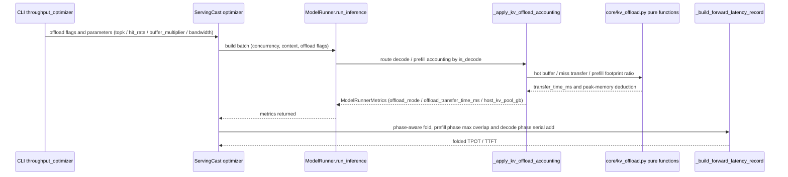

# RFC: KV Cache Offload Performance Modeling

## Metadata

| Field | Content |
| :--- | :--- |
| **Status** | Draft |
| **Author** | @hanxinlong1999 |
| **Created** | 2026-08-31 |
| **Related** | vLLM RFC #48203; vllm-ascend design doc `layerwise_and_sparse_kv_cache_offloading` |
| **Implementation** | Phase 0–2 implemented in [!784](https://gitcode.com/Ascend/msmodeling/merge_requests/784) (`feat/kv-offload-phase0`); Phase 3 not implemented |

---

## 1. Overview

msmodeling is a performance simulation framework. This RFC does **not** implement an offload engine; instead it models the performance cost of vLLM-ascend's layerwise + sparse KV cache offload mechanism **into ServingCast / TensorCast**, so that `python -m cli.inference.throughput_optimizer` can evaluate how TTFT / TPOT / throughput / max-batch change when offload is enabled.

Two complementary strategies (aligned with upstream RFC #48203):

- **Decode sparse offload**: device main KV is removed, only indexer + per-layer top-k hot buffers remain; each step onloads only miss rows from host by hit rate. Upstream measured DeepSeek-V3.2 hit rate of 80%–90% at buffer=2×top_k.
- **Prefill layerwise offload**: N cache-bearing layers share B(2–4) physical NPU buffers; full-layer KV is shuttled host↔NPU, hiding transfer latency behind prefill per-layer compute; main KV NPU footprint is compressed to `(I+min(B,R))/N`.

The two features are **independently toggleable and evaluated separately**; implemented in two phases — Decode first, Prefill second — sharing a substrate (host bandwidth attribute + memory tiering + transfer op). At implementation time Phase 0 (substrate) + Phase 1 (Decode) + Phase 2 (Prefill) were merged into the single implementation PR !784 (`feat/kv-offload-phase0`); Phase 3 is left for later.

---

## 2. Detailed Design

### 2.1 Upstream master scan conclusions

Reuse items (all confirmed present on `origin/master`; located by file + symbol, no line numbers — they drift as master evolves):

| Capability | Location |
| :--- | :--- |
| Per-layer / per-token KV bytes + indexer split | `tensor_cast/core/input_generator.py` `_get_kv_cache_info`; `tensor_cast/core/model_runner.py` (`kv_cache_size_gb` / `indexer_cache_size_gb`, `ModelRunnerMetrics`) |
| Memory budget & OOM early-stop | `serving_cast/model_runner.py` `warmup`/`num_blocks`; `serving_cast/service/base_throughput_optimizer.py` |
| PD disaggregation + PD ratio | `serving_cast/service/pd_ratio_throughput_optimizer.py` `PDRatioThroughputOptimizer`; `serving_cast/parallel_runner.py` `_run_pd_ratio` |
| Sparse top-k decode attention cost | `tensor_cast/performance_model/__init__.py` `mla_sparse_attention` op (op-properties registration) + `_estimate_sparse_mla_paged_kv_read_breakdown`; empirical `tensor_cast/performance_model/profiling_database/profiling_data_source.py` `_decompose_mla_sparse` |
| Cross-node KV transfer (Path B simulator) | `serving_cast/communication.py` `Channel`/`get_estimated_communication_time`; `serving_cast/engine.py` `_send_kvs_from_remote` `device2device_async` |
| Transfer op template | `tensor_cast/performance_model/__init__.py` `_estimate_pipeline_send_recv` |
| DeviceProfile interconnect | `tensor_cast/device.py` `InterconnectTopology` (bw/latency/eff) + `CommGrid` |
| Roofline + Cube/Vec/Comm/Mem breakdown | `tensor_cast/performance_model/__init__.py` `_estimate_default_without_static_cost`; `bound_analyzer.py` |

Net-new items (absent in repo; `offload`/`host_bandwidth`/`pinned` keyword search empty):

| Gap | Current state |
| :--- | :--- |
| host↔NPU transfer op/bandwidth | TensorCast has zero H2D/D2H/DMA; `DeviceProfile` has no host bandwidth field |
| Compute/transfer overlap | None anywhere: roofline is `max(compute,mem)`, `Channel` is pure bandwidth-blocking |
| Offload memory tiering | `warmup` assumes all KV in HBM |
| Decode miss-row transfer + hit rate | Sparse attention compute cost exists; transfer/hit-rate do not |
| Unequal TP / contributor group | Absent; P/D only differ via two independent searches with different device counts |
| Path A zero transfer | Optimizer never calls `CommunicationManager` |

### 2.2 Shared substrate (Phase 0, both phases depend on it)

- `DeviceProfile` (`tensor_cast/device.py`) gains three fields `host_bandwidth_bytes_ps: float` / `host_latency_s: float` / `host_transfer_efficiency: float` (mirroring `InterconnectTopology`; defaults 0/0/1.0 = host link unmodeled, offload paths short-circuit). Calibration values are added in `device.py` for all 24 Atlas A2/A3/A5 profiles: A3 is calibrated to the confirmed specification of 70 GB/s/die/direction (the dual-die card provides 28×5 = 140 GB/s per direction, `A3_HOST_BANDWIDTH_BYTES_PS`; `host_transfer_efficiency` stays 0.8 until pinned copy measurements decide whether the 80/120 GB/s per-card empirical readings are already effective bandwidth); **A2/A5 host links are uncalibrated and set to 0** — enabling KV offload on them fails fast instead of silently producing results that move with a magic constant (per-device measured values will be committed once confirmed); `TEST_DEVICE` uses a 32 GB/s development placeholder (NPU↔Host PCIe Gen5 x16).
- Register new op `tensor_cast.kv_offload_transfer` (`tensor_cast/ops/communication.py`; `direction` 0 = D2H save / 1 = H2D onload) + estimator `_estimate_kv_offload_transfer` (mirroring `_estimate_pipeline_send_recv`):

  ```python
  time_s = host_latency_s + payload_bytes / (host_bandwidth_bytes_ps * host_transfer_efficiency)
  ```

  Accounting semantics (aligned with the implementation): the op and estimator currently serve as the Roofline pricing vehicle for the host transfer and a placeholder for future `Runtime` op-dispatch integration — the Runtime path does not emit them yet. The real offload cost is computed by `ModelRunner` as independent scalar accounting (the decode/prefill accounting functions derive `offload_transfer_time_ms` directly with the same formula and fold it into `ModelRunnerMetrics`, see §2.3/§2.4); op records / trace / breakdown do not contain this transfer. Both the estimator and the `ModelRunner` accounting path fail fast on `host_bandwidth_bytes_ps <= 0` (no silent zeros on misconfigured profiles).
- `ModelRunnerMetrics` (`tensor_cast/core/model_runner.py`) gains fields: `offload_mode` (none/decode/prefill), `host_kv_pool_gb`, `offload_transfer_time_ms` (defaults none/0/0 — byte-identical when off), surfaced to the optimizer summary.

### 2.3 Decode sparse offload (Phase 1, first)

Memory model (hook: `tensor_cast/core/model_runner.py:run_inference` peak post-processing `_apply_decode_kv_offload_accounting`; **does not touch** `_get_kv_cache_info` per-layer shapes or `warmup` — the optimizer only uses `device_memory_available_gb` for OOM early-stop, so adjusting peak in `run_inference` suffices, same hook as Phase 2):

- On a decode step with the flag on, the main KV moves to host: `peak -= main_kv` (`host_kv_pool_gb = main_kv`); indexer retained (existing `indexer_cache_size_gb`); device-resident KV becomes indexer + hot buffer.
- New top-k hot buffer term: `num_seqs * top_k * buffer_multiplier * main_kv_per_token_bytes`. `num_seqs` expands from request concurrency as `(c+dp-1)//dp` (mirroring `generate_inputs`); `main_kv_per_token_bytes` is the all-layer per-token main-KV bytes (= `num_layers * kv_head_dim * 2(K+V) * dtype_bytes / tp_kv`).
- The grown `device_memory_available_gb` lets the existing OOM early-stop automatically find a larger max-batch / max-seq (zero new logic on the benefit side).
- Known capacity-semantics gap (review P2): the ServingCast `warmup` block capacity still divides by the full `kv_cache_per_token_gb` — the resident KV freed by offload does **not** change warmup's `num_blocks`; the optimizer benefit flows through the `device_memory_available` OOM search. The two capacity semantics are a known limitation.

Op cost: directly reuse `mla_sparse_attention` estimator (with page efficiency `_estimate_sparse_mla_paged_kv_read_breakdown`), unchanged.

New cost — per-step miss-row H2D:

- Hit rate: `--decode-offload-hit-rate` defaults to 0.85 (conservative lower bound of upstream 80%–90% at buffer=2×top_k), manually overridable; `miss_rate = 1 - hit_rate`.
- Miss rows (independent misses per layer): `miss_rows_per_layer = ceil(top_k * miss_rate)`.
- Transfer (priced directly by `ModelRunner` through the pure function `decode_offload_miss_transfer_time_ms`, using the same formula as the Phase 0 estimator — no op-dispatch involved, see §2.2 accounting semantics); the payload splits into two components, both scaled by the number of active sequences `num_seqs` (each request misses and writes back independently):
  - miss H2D: `num_seqs × miss_rows_per_layer × main_kv_per_token_bytes`;
  - new-KV D2H write-back: `num_seqs × 1 × main_kv_per_token_bytes` (with the main KV on host, each generated token's KV must be persisted back step by step — `hit_rate = 1` is never free);
  - combined: `miss_transfer_ms = (host_latency_s + num_seqs * (miss_rows_per_layer + 1) * main_kv_per_token_bytes / (host_bandwidth * efficiency)) * 1000` (reserved `swap_kernel_ms` param defaults to 0).
  `main_kv_per_token_bytes` already covers every cache-bearing layer on the current rank (= `num_layers × row_bytes`, `row_bytes = kv_head_dim * 2 * dtype_bytes`); under the uniform-layer assumption `num_layers` cancels exactly in the product, so the payload uses the per-layer miss-row count times the all-layer byte width and no `num_layers` factor appears.
- Fold into TPOT: `tpot_off = decode_latency_per_token + miss_transfer_ms`, added serially (decode steps have little compute to hide the transfer under). The fold covers every latency path that consumes the metrics — `_build_forward_latency_record`, the disagg single-shape branch, the disagg variable-length chunk loop and the agg chunked-prefill loop all converge on the shared pure function `fold_offload_transfer_time_ms` (`tensor_cast/core/kv_offload.py`), keeping the phase awareness (decode serial add / prefill max overlap) in one place.
- Validation & rejection (review hardening): when decode offload is enabled, a sparse window that fails to resolve from the model checkpoint config or is non-positive (`top_k`), a non-positive host bandwidth, a model without an indexer cache (dense/GQA), or `buffer_multiplier < 1` (a sub-1x hot buffer cannot hold one full top-k window, so a positive hit rate has no physical carrier — 10-09 review) each raise `ValueError` — a "remove the whole main KV with zero transfer" free benefit is impossible.

CLI (declarative parameter registry `cli/registry/modules/throughput_optimizer.py`, exposed via `cli.inference.throughput_optimizer`):

| Flag | Default | Description |
| :--- | :--- | :--- |
| `--enable-decode-kv-offload` | off | Enable Decode sparse offload |
| `--decode-offload-buffer-multiplier` | 2.0 | hot buffer = multiplier × top_k (**≥ 1**: the buffer must hold one full window for a deployable positive hit rate) |
| `--decode-offload-hit-rate` | 0.85 | hot buffer hit rate (conservative lower bound; upstream 2×top_k measures 80–90%) |

The top-k sparse window and the host link bandwidth are **not CLI flags**: the window is resolved from the model checkpoint config (`index_topk`, or the adapter-normalized `topk_limit` + `index_n_heads`), and enabling Decode offload fails fast when the config declares none; the bandwidth comes from the DeviceProfile `host_bandwidth_bytes_ps` (A3 die-level theoretical peak 70 GB/s; per-device calibration is a standing open item).

### 2.4 Prefill layerwise offload (Phase 2, aggregate max first version)

Memory model (hook: `tensor_cast/core/model_runner.py:run_inference` peak post-processing; **does not touch** `_get_kv_cache_info` per-layer shapes or `warmup` — the optimizer only uses `device_memory_available_gb` for OOM early-stop, so adjusting peak in `run_inference` suffices):

- Main KV NPU footprint ratio = `prefill_layerwise_footprint_ratio(N, I, B) = (I + min(B, R)) / N`, `R = N - I` (I = non-shareable independent layers; the helper rejects negative arguments and clamps I to N). **N counts the cache-bearing layers that actually hold paged KV** (linear-attention layers are already excluded via `kv_cache_excluded_layer_indices`, 10-09 review) — dividing by the total hidden-layer count would manufacture a phantom capacity gain on hybrid models (e.g. 2 KV layers out of 8 give 2/2, not 2/8); when cache-bearing layers have non-uniform KV widths, enabling prefill offload raises `ValueError` outright instead of silently applying a uniform ratio. `peak -= main_kv * (1 - ratio)` → `device_memory_available` grows so the optimizer finds a larger prefill batch (the benefit); `host_kv_pool_gb = main_kv * (1 - ratio)` (**only the actually offloaded share counts toward the host pool**).

Cost — aggregate max overlap model (first version. **For uniform-layer models, the aggregate `max(compute, transfer)` equals the per-layer `Σ max(compute_l, transfer_l)` mathematically; the k-stage pipeline carries fill/drain residue (the first H2D precedes the first layer's compute, the final D2H follows the last layer), so the aggregate max is an optimistic approximation of it**; each step also carries one host-link latency term; the per-layer makespan upgrade only differs for non-uniform/hybrid models, tracked as an open enhancement):

- Per prefill step transfer = `host_latency_s + 2 * main_kv * (1 - ratio) / (host_bandwidth * efficiency)` (d2h+h2d round trip plus one host-link latency term, covering only the offloaded share; host link is a serial stream).
- TTFT fold-in is phase-aware (`base_throughput_optimizer._build_forward_latency_record`): prefill `latency = max(compute, transfer)` (transfers hide under compute → ≈ unchanged; only when transfer>compute does it add), decode uses `+` (serial miss). **Every latency path consuming `ModelRunnerMetrics` folds exactly once**: beyond `_build_forward_latency_record`, the disagg variable-length chunk loop, the agg chunked-prefill loop, and the disagg single-shape branch are all covered (review P1-4 hardening). `getattr`+`isinstance` guards keep it robust to metrics mocks.

> The originally-envisioned `Runtime._build_model_timelines` per-layer overlap surgery (per-layer compute attribution + emit `kv_offload_transfer` per layer + `Σ max`) is **deferred** — for uniform-layer models aggregate max is already equivalent, the surgery has low ROI and only covers the non-uniform subset. Left as an open enhancement for non-uniform/hybrid-model fidelity.

CLI:

| Flag | Default | Description |
| :--- | :--- | :--- |
| `--enable-prefill-kv-offload` | off | Enable Prefill layerwise offload |

B and I are **not CLI flags**: they are fixed code-level defaults, `B=2` (upstream-measured anchor: 80–90% hit rate at 2×top_k) and `I=0` (all layers of currently adapted models are cache-bearing), see `ModelRunner._PREFILL_OFFLOAD_*`; deriving I for hybrid models is an open item.

### 2.5 PD disaggregation and unequal TP

> **Status note (delivery boundary & scheduling)**: the third bullet (Path A integration) landed with !784; the first two are design intent, **not implemented in !784** (no `pd_ratio` / `communication` changes). Delivered scope = Phase 0–2 full chain in single-node agg mode (offload benefit/cost accounting, end-to-end smoke validated); in PD-ratio mode (pp=1 on both sides) the P/D searches reuse the same `ModelRunner` / `BaseThroughputOptimizer`, so offload memory/latency accounting flows through — but cross-node KV transfer accounting under offload semantics is neither modeled nor validated, and this combination is not advertised as a supported capability. **PP (pipeline parallel, pp>1) and offload are mutually exclusive**: the PP path never runs the offload accounting, so enabling both raises `ValueError` (review hardening); PP support is deferred.
>
> **Scheduling**: the first two are not scheduled proactively; both are demand-triggered — start cross-node transfer modeling (flat bandwidth approximation first) when a real "evaluate offload on PD clusters" need appears; evaluate contributor-group high fidelity only when "unequal-TP deployment planning" appears and the flat approximation is insufficient. Current priority goes to the §4 open items: per-device host bandwidth calibration and hit-rate curve calibration (finer transfer modeling adds little before the calibration inputs exist).

- Reuse `PDRatioThroughputOptimizer` + `_run_pd_ratio`: P/D each have their own device budget, search TP/batch independently, TTFT from prefill, TPOT from decode — naturally supports "evaluate benefits separately".
- Cross-node KV transfer: reuse `device2device_async` (existing, Path B); unequal TP (p_tp≥d_tp divisible, contributor group, disjoint indexer ranges) **first version uses a flat bandwidth approximation**: `cross_node_kv_bytes / d2d_bandwidth`, not modeling contributor splitting. High fidelity deferred to Phase 3.
- Path A integration (mandatory change point): offload memory benefit and transfer cost must enter `base_throughput_optimizer` latency/memory accounting (Path A has zero transfer today).

### 2.6 Overall architecture flow

```text
CLI (throughput_optimizer.py)
  │  new: --enable-decode-kv-offload / --enable-prefill-kv-offload, etc.
  ▼
ParallelRunner (_run_pd_ratio: P/D each searched independently)
  │
  ├─ P search → ModelRunner(offload-aware memory) → BaseThroughputOptimizer(add transfer/memory offload cost) → ttft
  └─ D search → ModelRunner(offload-aware memory) → BaseThroughputOptimizer(add miss-row transfer) → tpot
  ▼
PDRatioThroughputOptimizer(combine P/D, compute QPS/ratio)
```

> Note: offload applies equally in agg (non-PD) mode — the memory/latency accounting lives in the shared `BaseThroughputOptimizer` path (the !784 end-to-end smoke was validated in agg mode).

The runtime call chain for a single batch evaluation (complementing the static layering above):



Example launch script (GLM-5.2 A3 PD disaggregation, offload on/off pair; the simplified CLI keeps only the switches and workload knobs — topk comes from the model config and bandwidth from the DeviceProfile):

```bash
export HF_HUB_OFFLINE=1
COMMON="--device ATLAS_800_A3_752T_128G_DIE --num-devices 32 --tp-sizes 8 --ep-sizes 4 \
  --performance-model analytic --disagg --jobs 1 --log-level info \
  --model-id zai-org/GLM-5.2 --max-batched-tokens 4096 --tpot-limit 70"
OFFLOAD="--enable-decode-kv-offload --decode-offload-buffer-multiplier 2.0 --decode-offload-hit-rate 0.85"

# Baseline
.venv/Scripts/python.exe -m cli.inference.throughput_optimizer $COMMON \
  --input-length 80000 --output-length 2048 --batch-range 10 10

# Enable Decode sparse offload (topk read from the model config index_topk; bandwidth from the DeviceProfile)
.venv/Scripts/python.exe -m cli.inference.throughput_optimizer $COMMON \
  --input-length 80000 --output-length 2048 --batch-range 10 10 $OFFLOAD
```

### 2.7 Modified files (actual !784 list, `origin/master...feat/kv-offload-phase0`, 19 files)

| File | Description |
| :--- | :--- |
| `tensor_cast/device.py` | host bandwidth/latency/efficiency fields + 24 A-series profiles and TEST_DEVICE calibration (A3 = 70 GB/s/die theoretical peak committed, `_HOST_LINK_*` constants) |
| `tensor_cast/core/kv_offload.py` (new) | pure functions: `decode_hot_buffer_bytes` / `decode_offload_miss_transfer_time_ms` / `prefill_layerwise_footprint_ratio` / `fold_offload_transfer_time_ms` (single point for the phase-aware fold) |
| `tensor_cast/core/user_config.py` | offload flags and parameter fields (default off; 4 fields kept after the 09-24 reduction — topk/bandwidth/B-I moved out) |
| `tensor_cast/core/model_runner.py` | `run_inference` peak post-processing (decode/prefill accounting) + new Metrics fields + `_resolve_model_sparse_topk` (config-derived window) + `_PREFILL_OFFLOAD_*` defaults |
| `tensor_cast/performance_model/__init__.py` + `tensor_cast/ops/communication.py` | `kv_offload_transfer` op + `_estimate_kv_offload_transfer` estimator |
| `serving_cast/service/base_throughput_optimizer.py` | Path A: TTFT/TPOT fold-in (phase-aware `max`/`+`, converged on the shared helper) |
| `serving_cast/service/disagg_throughput_optimizer.py` | phase-aware fold-in for the single-shape branch + variable-length chunk loop |
| `serving_cast/service/agg_throughput_optimizer.py` | phase-aware fold-in for the agg chunked-prefill loop |
| `serving_cast/parallel_runner.py` | workload cache bypass when offload is enabled (+ warning log) |
| `cli/registry/modules/throughput_optimizer.py` | declarative parameter registry (4 offload params after the 09-24 reduction) |
| `web_ui/backend/services/ui_props/throughput_optimizer.py` | UIFieldProps kept in sync with the registry (enforced by UT integrity tests) |
| `docs/zh/user_guide/msmodeling_throughput_optimizer_user_guide.md`, `docs/en/user_guide/msmodeling_throughput_optimizer_user_guide.md` | user guide: new KV Cache Offload scenario (example + constraints) and the four CLI params |
| `docs/zh/user_guide/support_matrix/support_matrix_user_guide.md`, `docs/en/user_guide/support_matrix/support_matrix_user_guide.md` | feature support matrix: new KV Cache Offload modeling entry |
| `cli/inference/throughput_optimizer.py` | CLI entry (offload params exposed via the declarative registry; no code change in this PR — listed for a complete CLI surface) |
| `.agents/skills/device_config/SKILL.md` | DeviceProfile constructor-parameter doc sync (review inline-comment fix) |
| `tests/regression/tensor_cast/test_kv_offload_transfer.py`, `test_kv_offload_model.py` (new) | offload unit tests |

---

## 3. Implementation plan

> Status: Phase 0–2 consolidated into the single implementation PR !784 and implemented (open, under review); Phase 3 not implemented.

- **Phase 0 shared substrate**: `DeviceProfile` host fields + `kv_offload_transfer` op + Metrics fields
- **Phase 1 Decode sparse offload**: `run_inference` peak post-processing + hit rate/miss-row transfer → fold into TPOT
- **Phase 2 Prefill layerwise offload**: aggregate max overlap model + round-trip transfer → fold into TTFT (per-layer/k-stage left as an open enhancement)
- **Phase 3 (optional) unequal TP high fidelity**: contributor group + disjoint indexer ranges

Test plan:

| Scenario | Description |
| :--- | :--- |
| Memory benefit comparison | max-batch / max-seq improvement with offload on/off |
| Hit rate calibration | buffer multiplier × hit_rate curve (vs upstream 2×→80–90%) |
| TPOT monotonicity | hit_rate↑ → miss transfer↓ → tpot↓ |
| TTFT monotonicity | B↑ → footprint↑ but overlapped ttft must not degrade far past the no-offload baseline |
| Path A/B consistency | optimizer and simulator offload cost within the same order of magnitude |
| Compatibility | no impact on existing agg/disagg modes; offload off yields results identical to current |

---

## 4. Open questions / open items

- **Overlap model fidelity**: aggregate max chosen for the first version (for uniform-layer models it equals the per-layer Σ max; the k-stage pipeline carries fill/drain residue, so the aggregate max is an optimistic approximation of it); the per-layer `Σ max` / k-stage pipeline upgrade only differs for non-uniform (hybrid attention, e.g. Qwen3.5/Kimi K3) models and needs runtime per-layer attribution surgery (emit layer markers in attention forward + inter-layer compute in `_build_model_timelines`), left as an open enhancement.
- **Host bandwidth calibration**: the A3 theoretical peak is confirmed and committed (70 GB/s/die/direction = 28×5 GB/s per direction × dual die, confirmed 2026-09); still open: (1) per-device real NPU↔Host PCIe measured values for A2/A5 — **now set to 0 (uncalibrated)**, so enabling KV offload on them fails fast instead of using a placeholder; (2) ownership split between the empirical tiers (typical/best ~80/120 GB/s per card, i.e. 40/60 GB/s/die effective) and `host_transfer_efficiency` — if pinned H2D/D2H copy measurements confirm the empirical readings are already effective bandwidth, the efficiency should be set to 1 to avoid double discounting with the current 0.8.
- **Host KV pool capacity gate**: **the fail-fast gate has landed (09-25) and became a search-domain signal (10-09 review)** — the `--host-memory-available-gb` knob (default 0 = check disabled); when set, decode/prefill offload accounting raises the dedicated `HostKVCapacityExceeded` (a `ValueError` subclass carrying the pool size and phase), which the optimizer catches at the candidate-evaluation boundary and folds into the existing OOM early-stop path (`device_memory_available_gb < 0`) — the search shrinks its upper bound and keeps feasible candidates instead of aborting the whole run; configuration errors (non-positive bandwidth, sub-1 multiplier, ...) keep plain `ValueError`. With over-budget rejection tests. Still open: `print_info()`/`dump_json()` output of `host_kv_pool_gb`, and entry-level on/off consumer ablation tests.
- **Hit-rate calibration**: empirical 0.85 @ buffer=2×top_k; the vs-buffer-multiplier curve depends on vLLM measurements, open.
- **Unequal TP high fidelity**: first version settled on a flat bandwidth approximation (`cross_node_kv_bytes / d2d_bandwidth`); contributor group + disjoint indexer ranges deferred to Phase 3 (demand-triggered, see the 2.5 scheduling note).
- **Workload cache coexistence with offload**: when offload is enabled the workload cache is fully bypassed today (replayed metrics would drop the offload state); the improvement path is to fold the offload state into the `make_model_key` cache key — pending verification that the replay path preserves the `offload_mode` / `offload_transfer_time_ms` fields (review 09-20; the option-2 warning log has landed).
- **Prefill offload applicability boundary**: no benefit under deployment shapes where TTFT is not relaxed (1M evidence: TTFT 232.84s → 1363.70s, a 5.86× degradation; every chunk step pays a full-KV host round trip, cost is O(context² / bandwidth)). Re-evaluation triggers: (1) single-request prefill KV exceeding the memory budget (longer contexts / wider-KV models — offload becomes an enabler); (2) chunk budgets scaled up in proportion to the memory freed by offload (keeping the compute/transfer ratio); (3) prefill-side compute headroom with memory as the concurrency bottleneck.

---

## 5. References

- vLLM RFC #48203 Layerwise and Sparse KV cache offloading
- vllm-ascend design doc `layerwise_and_sparse_kv_cache_offloading`
- Related upstream: #33398, #33980, HiSparse #49629
- In-repo status: `rfc_pd_ratio_throughput_optimization_zh.md`, `rfc_mixed_batch_variable_tokens_zh.md`, `rfc_pipeline_parallel_*`
