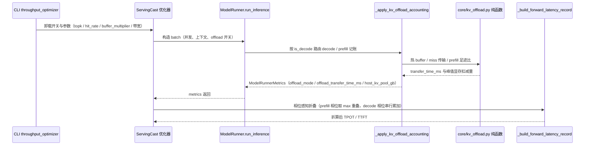

# RFC: KV Cache Offload 性能建模

## 元数据

| 项目 | 内容 |
| :--- | :--- |
| **状态** | Draft |
| **作者** | @hanxinlong1999 |
| **创建日期** | 2026-08-31 |
| **相关链接** | vLLM RFC #48203、vllm-ascend 设计文档 `layerwise_and_sparse_kv_cache_offloading` |
| **实现状态** | Phase 0–2 已实现于 [!784](https://gitcode.com/Ascend/msmodeling/merge_requests/784)（`feat/kv-offload-phase0`）；Phase 3 未实现 |

---

## 1. 概述

msmodeling 是性能仿真框架。本 RFC **不实现 offload 引擎**，而是把 vLLM-ascend 的 layerwise + sparse KV cache offload 机制的性能代价**建模进 ServingCast / TensorCast**，使 `python -m cli.inference.throughput_optimizer` 能评估"开启 offload 后 TTFT / TPOT / 吞吐 / max-batch 如何变化"。

两条互补策略（与上游 RFC #48203 对齐）：

- **Decode 稀疏 offload**：device 主 KV 移除，仅留 indexer + 每层 top-k 热 buffer；每步按命中率只把 miss 行从 Host 拉回 NPU。上游实测 DeepSeek-V3.2 在 buffer=2×top-k 下命中率 80%–90%。
- **Prefill 层级 offload**：N 个有 cache 层共享 B(2–4) 个物理 NPU buffer，整层 KV 在 Host↔NPU 间搬运，靠 Prefill 单层算力与传输重叠藏住延迟；主 KV NPU 占比压成 `(I+min(B,R))/N`。

两条特征**独立可开关、分开算收益**；分两阶段实施：先 Decode 后 Prefill，共享一个底座（host 带宽属性 + 显存分层 + 传输算子）。实施时 Phase 0（底座）+ Phase 1（Decode）+ Phase 2（Prefill）合并为单个实现 PR !784（`feat/kv-offload-phase0`），Phase 3 留待后续。

---

## 2. 详细设计

### 2.1 上游 master 现状扫描结论

复用项（均在 `origin/master` 确认存在；定位到文件 + 符号，不标行号——行号随 master 演进漂移）：

| 能力 | 位置 |
| :--- | :--- |
| 逐层/逐 token KV 字节 + indexer 区分 | `tensor_cast/core/input_generator.py` `_get_kv_cache_info`；`tensor_cast/core/model_runner.py`（`kv_cache_size_gb` / `indexer_cache_size_gb`、`ModelRunnerMetrics`） |
| 显存预算 & OOM 早停 | `serving_cast/model_runner.py` `warmup`/`num_blocks`；`serving_cast/service/base_throughput_optimizer.py` |
| PD 分离 + PD ratio | `serving_cast/service/pd_ratio_throughput_optimizer.py` `PDRatioThroughputOptimizer`；`serving_cast/parallel_runner.py` `_run_pd_ratio` |
| 稀疏 top-k decode attention 成本 | `tensor_cast/performance_model/__init__.py` `mla_sparse_attention` op（op-properties 注册）+ `_estimate_sparse_mla_paged_kv_read_breakdown`；实测 `tensor_cast/performance_model/profiling_database/profiling_data_source.py` `_decompose_mla_sparse` |
| 跨节点 KV 传输（Path B 仿真器） | `serving_cast/communication.py` `Channel`/`get_estimated_communication_time`；`serving_cast/engine.py` `_send_kvs_from_remote` `device2device_async` |
| 传输算子模板 | `tensor_cast/performance_model/__init__.py` `_estimate_pipeline_send_recv` |
| DeviceProfile 互联 | `tensor_cast/device.py` `InterconnectTopology`（bw/latency/eff）+ `CommGrid` |
| roofline + Cube/Vec/Comm/Mem 拆解 | `tensor_cast/performance_model/__init__.py` `_estimate_default_without_static_cost`；`bound_analyzer.py` |

净新增项（仓库无，`offload`/`host_bandwidth`/`pinned` 关键词空命中）：

| 缺口 | 现状 |
| :--- | :--- |
| host↔NPU 传输算子/带宽 | TensorCast 零 H2D/D2H/DMA；`DeviceProfile` 无 host 带宽字段 |
| 计算/传输重叠 | 全仓无：roofline 是 `max(compute,mem)`，`Channel` 纯带宽阻塞 |
| offload 显存分层 | `warmup` 假设 KV 全在 HBM |
| Decode miss 行传输 + 命中率 | 稀疏 attention 计算成本已有，传输/命中率无 |
| 不等 TP / contributor group | 无；P/D 仅靠两次独立搜索拿不同设备数 |
| Path A 零传输 | 优化器从不调 `CommunicationManager` |

### 2.2 共享底座（Phase 0，两阶段都依赖）

- `DeviceProfile`（`tensor_cast/device.py`）新增 `host_bandwidth_bytes_ps: float` / `host_latency_s: float` / `host_transfer_efficiency: float` 三个字段（仿 `InterconnectTopology` 形状；默认 0/0/1.0 = 不建模 host 链路，offload 路径短路）。在 `device.py` 内为 Atlas A2/A3/A5 系列共 24 个 profile 补校准值：A3 已按确认规格校准为 70 GB/s/die/方向（单卡双 die 每方向 28×5 = 140 GB/s 理论峰值，`A3_HOST_BANDWIDTH_BYTES_PS`；`host_transfer_efficiency` 保留 0.8，待 pinned 拷贝实测判定 80/120 GB/s 经验体感是否已是有效带宽）；**A2/A5 的 host 带宽未校准、置 0**——在这些设备上开启 offload 会 fail-fast 拒绝，而不是以正数占位产生随魔法常量漂移的结果（待 per-device 实测后按确认值入码）；`TEST_DEVICE` 保留 32 GB/s 开发占位（NPU↔Host PCIe Gen5 x16）。
- 注册新算子 `tensor_cast.kv_offload_transfer`（`tensor_cast/ops/communication.py`；`direction` 0 = D2H 落盘 / 1 = H2D 回载）+ 估算器 `_estimate_kv_offload_transfer`（仿 `_estimate_pipeline_send_recv`）：

  ```python
  time_s = host_latency_s + payload_bytes / (host_bandwidth_bytes_ps * host_transfer_efficiency)
  ```

  账务口径（与实现对齐）：该算子与估算器当前作为 host 传输的算子级 Roofline 计价载体与未来 Runtime op-dispatch 接入的预留，Runtime 路径暂不 emit；真实 offload 成本由 `ModelRunner` 独立标量账务直接计算（decode/prefill 记账函数按同一公式得出 `offload_transfer_time_ms` 折入 `ModelRunnerMetrics`，见 §2.3/§2.4），op records / trace / breakdown 不含该传输。估算器与 `ModelRunner` 账务路径均对 `host_bandwidth_bytes_ps <= 0` fail-fast（防止误用未配置 profile 静默算零）。
- `ModelRunnerMetrics`（`tensor_cast/core/model_runner.py`）新增字段：`offload_mode`(none/decode/prefill)、`host_kv_pool_gb`、`offload_transfer_time_ms`（默认 none/0/0，关闭时字节级不变），供优化器汇总。

### 2.3 Decode 稀疏 offload（Phase 1，先做）

显存模型（落点 `tensor_cast/core/model_runner.py:run_inference` peak 后处理 `_apply_decode_kv_offload_accounting`；**不动** `_get_kv_cache_info` 逐层 shape 与 `warmup`——优化器只用 `device_memory_available_gb` 做 OOM 早停，故只在 `run_inference` 调 peak 即可，与 Phase 2 同一落点）：

- decode + flag 时主 KV 移至 host：`peak -= main_kv`（`host_kv_pool_gb = main_kv`）；保留 indexer（已有 `indexer_cache_size_gb`），设备侧 KV 变为 indexer + 热 buffer。
- 新增 top-k 热 buffer 项：`num_seqs * top_k * buffer_multiplier * main_kv_per_token_bytes`。`num_seqs` 按 requests 并发以 `(c+dp-1)//dp` 展开（镜像 `generate_inputs`）；`main_kv_per_token_bytes` 为全层每 token 主 KV 字节（= `num_layers * kv_head_dim * 2(K+V) * dtype_bytes / tp_kv`）。
- 腾出的 `device_memory_available_gb` 变大后，优化器现有 OOM 早停自动搜到更大 max-batch / max-seq（收益侧零新增逻辑）。
- 已知容量口径差异（评审 P2）：ServingCast `warmup` 的 block 容量仍按完整 `kv_cache_per_token_gb` 估算——offload 减少的驻留 KV **不改变 warmup 的 `num_blocks`**，优化器收益经 `device_memory_available` 的 OOM 搜索体现；两条容量口径不一致为已知限制。

算子成本：直接复用 `mla_sparse_attention` 估算器（含 page 效率 `_estimate_sparse_mla_paged_kv_read_breakdown`），不改。

新增代价——per-step miss 行 H2D：

- 命中率：`--decode-offload-hit-rate` 默认 0.85（上游实测 buffer=2×top_k 下 80%–90% 的保守下界），可手动覆盖；`miss_rate = 1 - hit_rate`。
- miss 行数（每层独立 miss）：`miss_rows_per_layer = ceil(top_k * miss_rate)`。
- 传输（由 `ModelRunner` 经纯函数 `decode_offload_miss_transfer_time_ms` 按与 Phase 0 估算器一致的公式直接计价，不经 op-dispatch，见 §2.2 账务口径），payload 拆分为两部分、均乘活跃序列数 `num_seqs`（每个请求独立 miss、独立回写）：
  - miss H2D：`num_seqs × miss_rows_per_layer × main_kv_per_token_bytes`；
  - 新 KV D2H 回写：`num_seqs × 1 × main_kv_per_token_bytes`（主 KV 在 host，每步新生成 token 的 KV 必须持久化回 host——`hit_rate = 1` 也不免费）；
  - 合计：`miss_transfer_ms = (host_latency_s + num_seqs * (miss_rows_per_layer + 1) * main_kv_per_token_bytes / (host_bandwidth * efficiency)) * 1000`（预留 `swap_kernel_ms` 参数默认 0）。
  `main_kv_per_token_bytes` 已覆盖当前 rank 的全部 cache-bearing layers（= `num_layers × row_bytes`，`row_bytes = kv_head_dim * 2 * dtype_bytes`）：均匀层假设下 `num_layers` 在乘法中精确消元，故 payload 直接用每层 miss 行数乘全层字节、不出现 `num_layers` 因子。
- 折进 TPOT：`tpot_off = decode_latency_per_token + miss_transfer_ms`，串行叠加（decode 步计算量小，传输藏不住）；折算覆盖所有消费 metrics 的延迟路径——`_build_forward_latency_record`、disagg 单形状分支、disagg 变长 chunk 循环、agg chunked prefill 循环四处已收敛至共享纯函数 `fold_offload_transfer_time_ms`（`tensor_cast/core/kv_offload.py`），相位感知（decode 串行 `+` / prefill max 重叠）单点维护。
- 校验与拒绝（评审加固）：开启 decode offload 时，稀疏窗口解析失败或 `top_k <= 0`（窗口解析自模型 checkpoint config，非 CLI 参数）、host 带宽 ≤ 0、模型无 indexer cache（dense/GQA）、`buffer_multiplier < 1`（热 buffer 连一个完整 top-k 窗口都装不下，正命中率没有物理载体——10-09 评审）任一命中即抛 `ValueError` 拒绝——不允许产生"移除全部主 KV 且零传输"的免费收益。

CLI（声明式参数注册表 `cli/registry/modules/throughput_optimizer.py`，经 `cli.inference.throughput_optimizer` 暴露）：

| 参数 | 默认 | 说明 |
| :--- | :--- | :--- |
| `--enable-decode-kv-offload` | off | 开启 Decode 稀疏 offload |
| `--decode-offload-buffer-multiplier` | 2.0 | 热 buffer = multiplier × top_k（**≥ 1**：buffer 须容纳完整窗口，正命中率才可部署） |
| `--decode-offload-hit-rate` | 0.85 | 热 buffer 命中率（保守下界；上游 2×top_k 实测 80–90%） |

top-k 稀疏窗口与 host 链路带宽**均不是 CLI 参数**：窗口从模型 checkpoint config 解析（`index_topk`，或适配器归一化的 `topk_limit` + `index_n_heads`），config 未声明时开启 Decode offload 即 fail-fast 拒绝；带宽取 DeviceProfile 的 `host_bandwidth_bytes_ps`（A3 die 级理论峰值 70 GB/s；per-device 标定为长期开放项）。

### 2.4 Prefill 层级 offload（Phase 2，aggregate max 首版）

显存模型（落点 `tensor_cast/core/model_runner.py:run_inference` peak 后处理；**不动** `_get_kv_cache_info` 逐层 shape 与 `warmup`——优化器只用 `device_memory_available_gb` 做 OOM 早停，故只在 `run_inference` 调 peak 即可）：

- 主 KV NPU 占比 = `prefill_layerwise_footprint_ratio(N, I, B) = (I + min(B, R)) / N`，`R = N - I`（I 为不可共享独立层；helper 拒绝负参数、I clamp 到 N）。**N 为实际持有 paged KV 的 cache-bearing 层数**（linear-attention 等无 KV 层已按 `kv_cache_excluded_layer_indices` 剔除，10-09 评审）——混合模型按总隐藏层数作分母会虚增容量收益（如 8 层仅 2 层有 KV 时 2/8 而非 2/2）；cache-bearing 层 KV 宽度不一致（非等宽布局）时开启 prefill offload 直接 `ValueError` 拒绝，不静默套用统一比例。`peak -= main_kv * (1 - ratio)` → `device_memory_available` 变大 → 优化器搜到更大 prefill batch（收益）；`host_kv_pool_gb = main_kv * (1 - ratio)`（**仅实际 offloaded 份额计入 host pool**）。
- 校验与拒绝：`ratio == 1`（无 offload 份额）时 host pool 与传输均为 0（no-op）；host 带宽 ≤ 0 时抛 `ValueError` 拒绝；PP>1（pipeline parallel）与 offload 互斥——PP 路径不执行 offload 账务，开启即拒绝。

代价——aggregate max 重叠模型（首版。**均匀层模型下 aggregate `max(compute, transfer)` 与 per-layer `Σ max(compute_l, transfer_l)` 数学相等；k-stage 流水线含 fill/drain 残余（首个 H2D 先于首层计算、末尾 D2H 后于末层），aggregate max 是其乐观近似**；且首版每步含一次 host 链路延迟项；per-layer makespan 升级只对非均匀/hybrid 模型有差异，记为开放增强）：

- 每 prefill 步 transfer = `host_latency_s + 2 * main_kv * (1 - ratio) / (host_bandwidth * efficiency)`（d2h+h2d 往返 + 一次链路延迟项，只计实际 offloaded 份额；host 链路串行流）。
- TTFT fold-in 相位感知（`base_throughput_optimizer._build_forward_latency_record`）：prefill `latency = max(compute, transfer)`（transfer 藏在 compute 下则≈不变；transfer>compute 才显式加），decode 用 `+`（串行 miss）。**所有消费 `ModelRunnerMetrics` 的延迟路径恰好折入一次**：`_build_forward_latency_record` 之外，disagg 变长 chunk 循环、agg chunked prefill 循环、disagg 单形状分支均已覆盖（评审 P1-4 加固）。`getattr`+`isinstance` 守卫对 metrics mock 鲁棒。

> 原 RFC 设想的 `Runtime._build_model_timelines` per-layer 重叠手术（层间 compute 归因 + 每 layer emit `kv_offload_transfer` + `Σ max`）**暂缓**——对均匀层模型 aggregate max 已等价，手术 ROI 低且只覆盖非均匀子集。留作非均匀/hybrid 模型保真度升级的开放增强。

CLI：

| 参数 | 默认 | 说明 |
| :--- | :--- | :--- |
| `--enable-prefill-kv-offload` | off | 开启 Prefill 层级 offload |

B 与 I **不是 CLI 参数**：固定为代码级默认 `B=2`（上游实测锚点：2×top_k 命中率 80–90%）、`I=0`（当前适配模型全部层有 cache），见 `ModelRunner._PREFILL_OFFLOAD_*`；hybrid 模型的 I 推导为开放项。

### 2.5 PD 分离与不等 TP

> **状态注记（交付边界与排期）**：第 3 条 Path A 接入已随 !784 落地；前两条为设计意图，**未随 !784 实现**（未改动 `pd_ratio` / `communication`）。已交付范围 = 单机 agg 模式 Phase 0–2 全链路（offload 收益/代价核算，端到端 smoke 已验证）；PD-ratio 模式（两侧 pp=1）下 P/D 各自搜索复用同一套 `ModelRunner` / `BaseThroughputOptimizer`，offload 显存/延迟账随之生效，但跨节点 KV 传输在 offload 语义下的记账未建模、未验证，该组合不作为已支持能力宣传。**PP（pipeline parallel，pp>1）与 offload 互斥**：PP 路径不执行 offload 账务，开启即 `ValueError` 拒绝（评审加固），PP 支持列为后续工作。
>
> **排期**：前两条不主动排期，按需求信号触发——出现"PD 集群评估 offload"的真实需求时启动跨节点传输建模（首版扁平带宽近似即可）；出现"不等 TP 部署规划"需求且扁平近似精度不足时再评估 contributor group 高保真；当前优先级为 §4 开放项的 host 带宽实测校准与命中率曲线标定（校准输入到位前，更细的传输建模意义有限）。

- 复用 `PDRatioThroughputOptimizer` + `_run_pd_ratio`：P/D 各自设备预算、各自搜 TP/batch，TTFT 取 prefill、TPOT 取 decode——天然支持"分开算收益"。
- 跨节点 KV 传输：复用 `device2device_async`（已有，Path B）；不等 TP（p_tp≥d_tp 整除、contributor group、不相交 indexer 区间）**首版用扁平带宽近似**：`cross_node_kv_bytes / d2d_bandwidth`，不建模 contributor 拆分。高保真留 Phase 3。
- Path A 接入（必改点）：offload 的显存收益与传输代价必须进 `base_throughput_optimizer` 的延迟/显存核算（今天 Path A 零传输）。

### 2.6 整体架构流程

```text
CLI (throughput_optimizer.py)
  │  新增: --enable-decode-kv-offload / --enable-prefill-kv-offload 等
  ▼
ParallelRunner (_run_pd_ratio: P/D 各自独立搜)
  │
  ├─ P 寻优 → ModelRunner(offload-aware 显存) → BaseThroughputOptimizer(叠加传输/显存 offload 代价) → ttft
  └─ D 寻优 → ModelRunner(offload-aware 显存) → BaseThroughputOptimizer(叠加 miss 行传输) → tpot
  ▼
PDRatioThroughputOptimizer(组合 PD, 计算 QPS/ratio)
```

> 注：agg（非 PD）模式下 offload 同样生效——显存/延迟叠加位于 `BaseThroughputOptimizer` 共享路径，!784 的端到端 smoke 即在 agg 模式验证。

单次 batch 评估的运行时调用链如下（与上图静态分层互补）：



示例启动脚本（GLM-5.2 A3 PD 分离，offload 开/关配对；简化后 CLI 仅保留开关与负载相关参数，topk 与带宽分别来自模型 config 与 DeviceProfile）。**注意：`--disagg` 模式下 offload 显存/延迟账务生效，但跨节点 KV 传输成本未建模（见 §2.5 状态注记）——数值仅供 D 侧评估参考**：

```bash
export HF_HUB_OFFLINE=1
COMMON="--device ATLAS_800_A3_752T_128G_DIE --num-devices 32 --tp-sizes 8 --ep-sizes 4 \
  --performance-model analytic --disagg --jobs 1 --log-level info \
  --model-id zai-org/GLM-5.2 --max-batched-tokens 4096 --tpot-limit 70"
OFFLOAD="--enable-decode-kv-offload --decode-offload-buffer-multiplier 2.0 --decode-offload-hit-rate 0.85"

# 基线
.venv/Scripts/python.exe -m cli.inference.throughput_optimizer $COMMON \
  --input-length 80000 --output-length 2048 --batch-range 10 10

# 开启 Decode 稀疏 offload（topk 读模型 config 的 index_topk；带宽用 DeviceProfile）
.venv/Scripts/python.exe -m cli.inference.throughput_optimizer $COMMON \
  --input-length 80000 --output-length 2048 --batch-range 10 10 $OFFLOAD
```

### 2.7 修改文件（!784 实际清单，`origin/master...feat/kv-offload-phase0` 共 19 文件）

| 文件 | 说明 |
| :--- | :--- |
| `tensor_cast/device.py` | host 带宽/延迟/效率字段 + A 系列 24 profile 与 TEST_DEVICE 校准值（A3 = 70 GB/s/die 理论峰值已入码，`_HOST_LINK_*` 常量） |
| `tensor_cast/core/kv_offload.py`（新增） | 纯函数：`decode_hot_buffer_bytes` / `decode_offload_miss_transfer_time_ms` / `prefill_layerwise_footprint_ratio` / `fold_offload_transfer_time_ms`（相位感知折叠单点维护） |
| `tensor_cast/core/user_config.py` | offload 开关与参数字段（默认关闭；09-24 精简后保留 4 字段，topk/带宽/B-I 移出） |
| `tensor_cast/core/model_runner.py` | `run_inference` peak 后处理（decode/prefill 账务）+ Metrics 新字段 + `_resolve_model_sparse_topk`（config 解析窗口）+ `_PREFILL_OFFLOAD_*` 默认值 |
| `tensor_cast/performance_model/__init__.py` + `tensor_cast/ops/communication.py` | `kv_offload_transfer` 算子 + `_estimate_kv_offload_transfer` 估算器 |
| `serving_cast/service/base_throughput_optimizer.py` | Path A：TTFT/TPOT fold-in（相位感知 `max`/`+`，收敛至共享 helper） |
| `serving_cast/service/disagg_throughput_optimizer.py` | 单形状分支 + 变长 chunk 循环的相位感知 fold-in |
| `serving_cast/service/agg_throughput_optimizer.py` | agg chunked prefill 循环的相位感知 fold-in |
| `serving_cast/parallel_runner.py` | workload cache 在 offload 开启时旁路（+ warning 日志） |
| `cli/registry/modules/throughput_optimizer.py` | 声明式参数注册表（09-24 精简后 offload 相关 4 参数） |
| `web_ui/backend/services/ui_props/throughput_optimizer.py` | UIFieldProps 与注册表同步（UT 完整性测试强制） |
| `docs/zh/user_guide/msmodeling_throughput_optimizer_user_guide.md`、`docs/en/user_guide/msmodeling_throughput_optimizer_user_guide.md` | 用户指南新增 KV Cache Offload 场景（示例 + 约束）与 4 个 CLI 参数说明 |
| `docs/zh/user_guide/support_matrix/support_matrix_user_guide.md`、`docs/en/user_guide/support_matrix/support_matrix_user_guide.md` | 特性支持矩阵新增 KV Cache Offload 建模条目 |
| `cli/inference/throughput_optimizer.py` | CLI 入口（offload 参数经声明式注册表暴露，本次无代码改动，列出以完整呈现 CLI 面） |
| `.agents/skills/device_config/SKILL.md` | DeviceProfile 构造参数文档同步（评审行内意见修复） |
| `tests/regression/tensor_cast/test_kv_offload_transfer.py`、`test_kv_offload_model.py`（新增） | offload 单测 |

---

## 3. 实施计划

> 状态：Phase 0–2 已合并为单实现 PR !784 并完成实现（open，评审中）；Phase 3 未实现。

- **Phase 0 共享底座**：`DeviceProfile` host 字段 + `kv_offload_transfer` 算子 + Metrics 字段
- **Phase 1 Decode 稀疏 offload**：`run_inference` peak 后处理 + 命中率/miss 行传输 → 折进 TPOT
- **Phase 2 Prefill 层级 offload**：aggregate max 重叠模型 + 往返传输 → 折进 TTFT（per-layer/k-stage 留开放增强）
- **Phase 3（可选）不等 TP 高保真**：contributor group + 不相交 indexer 区间

测试计划：

| 场景 | 说明 |
| :--- | :--- |
| 显存收益对比 | offload on/off 下 max-batch / max-seq 提升 |
| 命中率标定 | buffer multiplier × hit_rate 曲线（对照上游 2×→80–90%） |
| TPOT 单调性 | hit_rate↑ → miss 传输↓ → tpot↓ |
| TTFT 单调性 | B↑ → 占比↑ 但重叠后 ttft 不应劣化超过无 offload 基线过多 |
| Path A/B 一致性 | 优化器与仿真器 offload 代价量级一致 |
| 兼容性 | 不影响现有 agg/disagg 模式；offload off 时结果与现状一致 |

---

## 4. 未解决问题 / 开放项

- **重叠模型保真度**：已选定 aggregate max 首版（对均匀层模型已精确，= per-layer Σ max = k-stage）；per-layer `Σ max` / k-stage 流水线升级只对非均匀（hybrid attention，如 Qwen3.5/Kimi K3）模型有差异，需运行时逐层归因手术（attention forward 发 layer 标记 + `_build_model_timelines` 层间 compute），留作开放增强。
- **host 带宽校准**：A3 理论峰值已实锤并入库（70 GB/s/die/方向 = 单卡 28×5 GB/s × 双 die，2026-09 确认）；仍开放：① A2/A5 的 per-device 真实 NPU↔Host PCIe 实测值——**现已置 0（未校准）**，在这些设备上开启 offload 会 fail-fast 拒绝，不再以正数占位绕过证据门；② 常态/最佳经验档（体感约 80/120 GB/s/卡，折算 40/60 GB/s/die effective）与 `host_transfer_efficiency` 的归属收口——若 pinned H2D/D2H 拷贝实测确认经验读数已是有效带宽，效率应设 1 以避免与 0.8 重复折算。
- **host KV pool 容量门禁**：**fail-fast 门禁已落地（09-25），10-09 按评审改为搜索域信号**——`--host-memory-available-gb`（默认 0 = 不限制）；>0 时 decode/prefill 卸载池超预算抛专用异常 `HostKVCapacityExceeded`（`ValueError` 子类，携带池大小与相位），优化器在候选评估边界捕获并折入现有 OOM early-stop 通路（`device_memory_available_gb < 0`）——搜索自动收缩上界并保留已有可行解，而非终止整轮寻优；配置非法（带宽 ≤ 0、multiplier < 1 等）仍为普通 `ValueError`。含超限拒绝测试。仍开放：候选级 auto-skip（当前超限整轮中止而非跳过该候选）、`print_info()`/`dump_json()` 输出 `host_kv_pool_gb`、消费者入口级 on/off 消融测试。
- **命中率标定**：现取 0.85 @ buffer=2×top_k 经验值；vs buffer-multiplier 曲线依赖 vLLM 实测，开放。
- **不等 TP 高保真**：首版已定用扁平带宽近似（`cross_node_kv_bytes / d2d_bandwidth`）；contributor group + 不相交 indexer 区间留 Phase 3（按需求信号触发，见 2.5 排期决策）。
- **workload cache 与 offload 的共存**：当前 offload 开启时完全旁路 workload cache（回放 metrics 会丢 offload 状态）；改进方向是将 offload 状态纳入 `make_model_key` 缓存键——需先验证回放路径对 `offload_mode`/`offload_transfer_time_ms` 字段的保真性（评审 09-20 提出，方案 2 的 warning 日志已落地）。
- **prefill offload 的适用边界**：TTFT 不放宽的部署形态下无收益（1M 实证：TTFT 232.84s → 1363.70s，5.86× 恶化；每 chunk 步支付全量 KV host 往返，成本 O(上下文²/带宽)）。重新评估的触发条件：① 单请求 prefill KV 超出显存预算（更长上下文 / 宽 KV 模型，offload 成为使能条件）；② chunk 预算随 offload 释放的显存等比放大（使 compute/transfer 比例保持）；③ P 侧算力有余量且显存成为并发瓶颈。

---

## 5. 参考资料

- vLLM RFC #48203 Layerwise and Sparse KV cache offloading
- vllm-ascend 设计文档 `layerwise_and_sparse_kv_cache_offloading`
- 相关上游：#33398、#33980、HiSparse #49629
- 本仓现状：`rfc_pd_ratio_throughput_optimization_zh.md`、`rfc_mixed_batch_variable_tokens_zh.md`、`rfc_pipeline_parallel_*`
