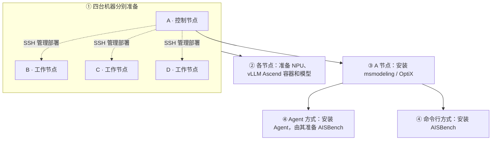

# PD 分离寻优公共环境准备

本文用于 PD 分离多机寻优，以四台 Atlas 800I A3 服务器和 vLLM Ascend 容器为例，A 为控制端。每台示例使用 16 个设备节点（0～15）。命令中的机器、设备、模型和路径均按实际环境替换。已有的环境可跳过对应步骤。



四台机器都需要镜像和可访问的模型文件，可共享存储或分别准备；OptiX 只需安装在 A 节点。Agent 方式可由 Agent 协助准备 AISBench。

## 1. 配置 SSH 免密连接

在 A 节点**宿主机**执行以下命令，为控制端准备专用密钥并将公钥添加到四台宿主机。示例使用相同的 SSH 账号和端口，请替换为实际值；账号需有权限操作各宿主机的 Docker 容器。

```bash
# 【必改】SSH 账号、端口和四台宿主机 IP
export OPTIX_SSH_USER='worker'
export OPTIX_SSH_PORT=22
export OPTIX_HOST_A='192.0.2.10'
export OPTIX_HOST_B='192.0.2.11'
export OPTIX_HOST_C='192.0.2.12'
export OPTIX_HOST_D='192.0.2.13'

sudo install -d -m 700 -o root -g root /data/optix-ssh
# 已有 root 所有的可用密钥时跳过此行
sudo ssh-keygen -t ed25519 -f /data/optix-ssh/id_ed25519 -N ''

for host in "$OPTIX_HOST_A" "$OPTIX_HOST_B" "$OPTIX_HOST_C" "$OPTIX_HOST_D"; do
  sudo ssh-copy-id -o UserKnownHostsFile=/data/optix-ssh/known_hosts -i /data/optix-ssh/id_ed25519.pub -p "$OPTIX_SSH_PORT" "$OPTIX_SSH_USER@$host"
done
```

首次连接时，在终端确认主机指纹并输入登录密码；不要将密码或私钥发送给 Agent。示例以 root 创建无口令的专用密钥，供以 root 运行的容器使用，请妥善保管 `/data/optix-ssh`。请使用本次任务专用密钥，不复用个人或团队共享密钥；已有本任务专用密钥时，确保目录、密钥和主机指纹文件归 root 所有，私钥权限为 `600`。Docker 权限及可访问机器和来源由管理员限定，任务结束后撤销授权并清理专用密钥。

PD 插件不读取 `~/.ssh/config` 中的别名、`IdentityFile` 或 `ProxyJump`。请填写实际地址，使用默认密钥路径或已加载密钥的 SSH agent；需要跳板机时，请管理员提供可直连的转发地址。

检查四台机器是否均显示 `SSH OK`：

```bash
for host in "$OPTIX_HOST_A" "$OPTIX_HOST_B" "$OPTIX_HOST_C" "$OPTIX_HOST_D"; do
  sudo ssh -i /data/optix-ssh/id_ed25519 -o UserKnownHostsFile=/data/optix-ssh/known_hosts -o BatchMode=yes -p "$OPTIX_SSH_PORT" "$OPTIX_SSH_USER@$host" 'echo SSH OK'
done
```

后续创建 A 节点容器时会挂载该密钥目录，容器内再验证一次连接及 Docker 权限。

## 2. 准备模型

从 [Hugging Face](https://huggingface.co/models) 或 [ModelScope（魔搭）](https://modelscope.cn/models) 下载模型，也可复用已有模型文件。本文以 `DeepSeek-V4-Flash-w8a8-mtp` 为例，模型目录为 `/mnt/share/weights/DeepSeek-V4-Flash-w8a8-mtp`。四台机器可使用共享目录，也可分别下载同一版本的模型到相同路径。

模型名称和路径按实际情况替换。没有模型时，可参考以下命令从 ModelScope 下载，将模型 ID 和目录替换为实际值：

```bash
python3 -m venv ~/modelscope-env
~/modelscope-env/bin/pip install modelscope
~/modelscope-env/bin/modelscope download --model '<组织名/模型名>' \
  --local_dir /mnt/share/weights/DeepSeek-V4-Flash-w8a8-mtp
```

共享存储下载一次即可；无共享存储时在各机器分别下载。

## 3. 下载镜像并启动容器：在四台宿主机分别执行

### 3.1 检查宿主机

```bash
npu-smi info
ls -l /dev/davinci{0..15}
docker version
```

确认设备和 Docker 正常。

### 3.2 下载配套镜像

从 [vLLM Ascend 安装说明](https://docs.vllm.ai/projects/ascend/en/main/getting_started/installation.html) 选择与硬件、驱动及 PD Connector 配套的镜像。确定与部署环境配套的完整镜像地址或 digest，然后在四台宿主机执行：

```bash
# 替换为与你的部署环境配套的实际镜像标签，不使用 latest。
export IMAGE='quay.io/ascend/vllm-ascend:v0.27.1rc1-a3'
docker pull "$IMAGE"
docker image inspect "$IMAGE" --format '{{json .RepoDigests}}'
```

四台使用相同镜像版本，并确认该镜像支持 PD 分离部署。

### 3.3 创建容器

工具通过 SSH 登录宿主机并操作容器。下面示例映射每台机器的 16 个设备节点（0～15），卡号不同时修改对应 `--device`。

示例在四台宿主机创建并挂载 `/data/msmodeling`，容器内路径为 `/workspace/msmodeling`。只需在 A 节点安装 msmodeling 和 OptiX。目录可自定义，需同步修改挂载命令和后续路径。

A 节点的容器需要挂载第 1 节准备的 SSH 密钥目录。示例命令也在其他节点挂载同一路径；如不需要，可在 B、C、D 节点删除该挂载行。容器名称 `optix-pd` 也可自定义；修改后同步替换所有 `docker exec` 命令及寻优配置中的容器名称。本文将宿主机 `/mnt/share/weights` 挂载到容器内的相同路径。

```bash
mkdir -p /data/msmodeling

docker run -d --name optix-pd \
  --network host --shm-size 512g \
  --device /dev/davinci0 --device /dev/davinci1 \
  --device /dev/davinci2 --device /dev/davinci3 \
  --device /dev/davinci4 --device /dev/davinci5 \
  --device /dev/davinci6 --device /dev/davinci7 \
  --device /dev/davinci8 --device /dev/davinci9 \
  --device /dev/davinci10 --device /dev/davinci11 \
  --device /dev/davinci12 --device /dev/davinci13 \
  --device /dev/davinci14 --device /dev/davinci15 \
  --device /dev/davinci_manager --device /dev/devmm_svm --device /dev/hisi_hdc \
  -v /usr/local/dcmi:/usr/local/dcmi:ro \
  -v /usr/local/bin/npu-smi:/usr/local/bin/npu-smi:ro \
  -v /usr/local/Ascend/driver:/usr/local/Ascend/driver:ro \
  -v /etc/ascend_install.info:/etc/ascend_install.info:ro \
  -v /mnt/share/weights:/mnt/share/weights:ro \
  -v /data/msmodeling:/workspace/msmodeling \
  -v /data/optix-ssh:/root/.ssh:ro \
  --entrypoint /bin/bash "$IMAGE" -lc 'sleep infinity'
```

共享内存示例为 512 GB，可根据宿主机内存和负载调整。RDMA 部署还需按所选镜像和网络方案映射 `/dev/infiniband` 等设备、设置相应权限及网络参数；由设备管理员确认。上面的基础容器命令不能替代 RDMA/HCCL 配置。host 网络下，同一宿主机的所有服务共享端口空间，必须避开已有业务端口。

检查四台容器：

```bash
docker exec optix-pd npu-smi info
docker exec optix-pd test -f /mnt/share/weights/DeepSeek-V4-Flash-w8a8-mtp/config.json
docker exec optix-pd bash -lc 'command -v vllm; vllm --help >/dev/null'
docker exec optix-pd python3 -c 'import vllm, vllm_ascend; print("vLLM imports OK")'
```

在 A 节点宿主机执行，验证容器内可免密连接四台宿主机，并有权限访问各自的容器：

```bash
for host in "$OPTIX_HOST_A" "$OPTIX_HOST_B" "$OPTIX_HOST_C" "$OPTIX_HOST_D"; do
  docker exec optix-pd ssh -o BatchMode=yes -p "$OPTIX_SSH_PORT" "$OPTIX_SSH_USER@$host" \
    'docker exec optix-pd bash -lc "command -v vllm && echo OK"'
done
```

四台均显示 vLLM 路径和 `OK` 后继续。如果重新打开了终端，请先重新设置第 1 节的 SSH 账号、端口和 IP。

通过标准：容器持续运行、16 个设备节点可见、模型可见、vLLM 命令和 Ascend 插件可用。镜像挂载要求参考 [官方快速开始](https://docs.vllm.ai/projects/ascend/en/main/getting_started/quick_start.html)，以对应版本说明为准。


## 4. 在控制端安装 OptiX 和 AISBench

在 A 节点宿主机执行 `docker exec -it optix-pd bash` 进入容器，以下命令在容器中执行。

### 4.1 下载 msmodeling 工具

msmodeling 就是包含 OptiX 和寻优 Skill 的工具仓库。下面将主仓 master 下载到上一节创建的挂载目录：

```bash
git clone --branch master https://gitcode.com/Ascend/msmodeling.git /tmp/msmodeling-source
cp -a /tmp/msmodeling-source/. /workspace/msmodeling/
cd /workspace/msmodeling
```

首次执行时目标目录应为空。已有工具时不要重复复制；在该目录执行 `git pull --ff-only origin master` 获取最新代码，若有本地修改先保留并处理。更新后重新执行下面的安装命令。

### 4.2 安装 OptiX

安装依赖可能需要一段时间。下载较慢时，可使用国内 PyPI 镜像：`export UV_DEFAULT_INDEX=https://pypi.tuna.tsinghua.edu.cn/simple`。部分依赖有独立下载源。

先按 [uv 安装说明](https://docs.astral.sh/uv/getting-started/installation/)安装 uv，然后在 msmodeling 仓库根目录执行：

```bash
uv sync
uv run msmodeling optix --help
```

显示帮助信息表示 OptiX 安装完成。vLLM 和 AISBench 分别使用独立环境。

### 4.3 安装 AISBench

AISBench 负责发送请求、统计吞吐和延迟。**Agent 方式可跳过本节及 4.4 节**，在寻优任务中让 Agent 检查并安装 AISBench。命令行方式请在 A 节点容器的独立环境中按下列步骤安装。安装方式参考 [AISBench 官方仓库](https://github.com/AISBench/benchmark)。

```bash
uv venv --python 3.10 /opt/aisbench-venv
uv pip install --python /opt/aisbench-venv/bin/python 'setuptools<81' \
  ais_bench_benchmark==3.1.20260630
/opt/aisbench-venv/bin/ais_bench --help

# 仅暴露 AISBench 命令，避免独立环境的 Python 覆盖 vLLM 的 Python。
mkdir -p /opt/optix-deploy/bin
ln -sfn /opt/aisbench-venv/bin/ais_bench /opt/optix-deploy/bin/ais_bench
export OPTIX_DEPLOY_PATH=/opt/optix-deploy
export PATH="/opt/optix-deploy/bin:$PATH"
```

采用固定版本便于复现。后续寻优需要在当前终端保持上述两个环境变量生效；重新进入容器或打开终端后，请重新执行两条 `export` 命令。安装路径可自定义，修改时同步调整命令及环境变量。

### 4.4 验证部署命令

命令行方式在完成 4.3 后保持环境变量生效，在 msmodeling 仓库根目录执行。Agent 方式可交由 Agent 检查：

```bash
uv run python - <<'PY'
from optix.deploy_env import resolve_deploy_context, validate_deploy_stack
ctx, env = resolve_deploy_context()
validate_deploy_stack(engine="vllm", benchmark="ais_bench", env=env, ctx=ctx)
PY
```

确认日志显示 `vllm` 和 `ais_bench` 的路径。vLLM 位于独立环境时，参照[部署环境说明](../install_guide/msmodeling_optix_env_and_deployment_stack.md)设置路径。

准备完成后选择 [Agent 方式](optix_agent_pd_disaggregation.md)或[命令行方式](optix_pso_pd_disaggregation.md)。
